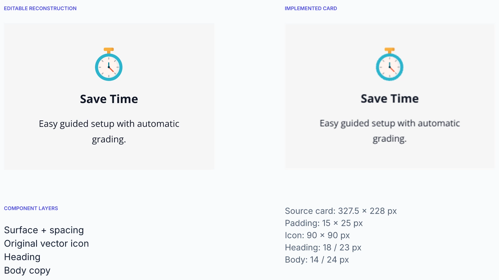
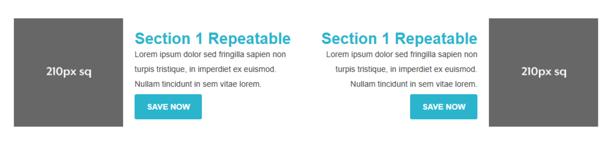
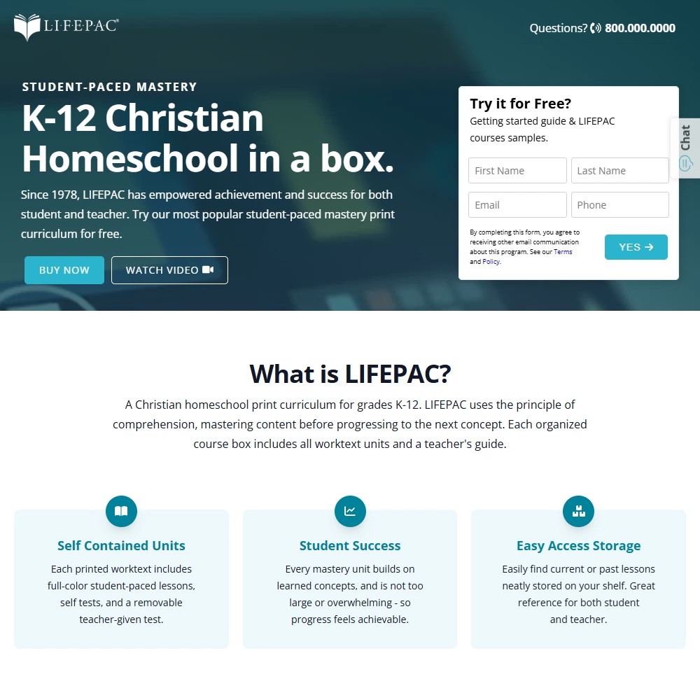
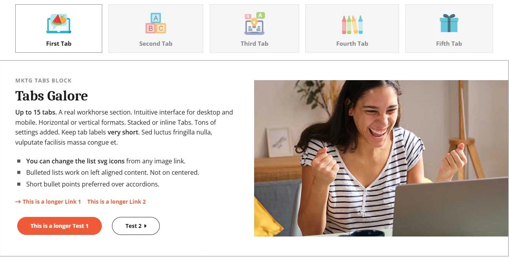
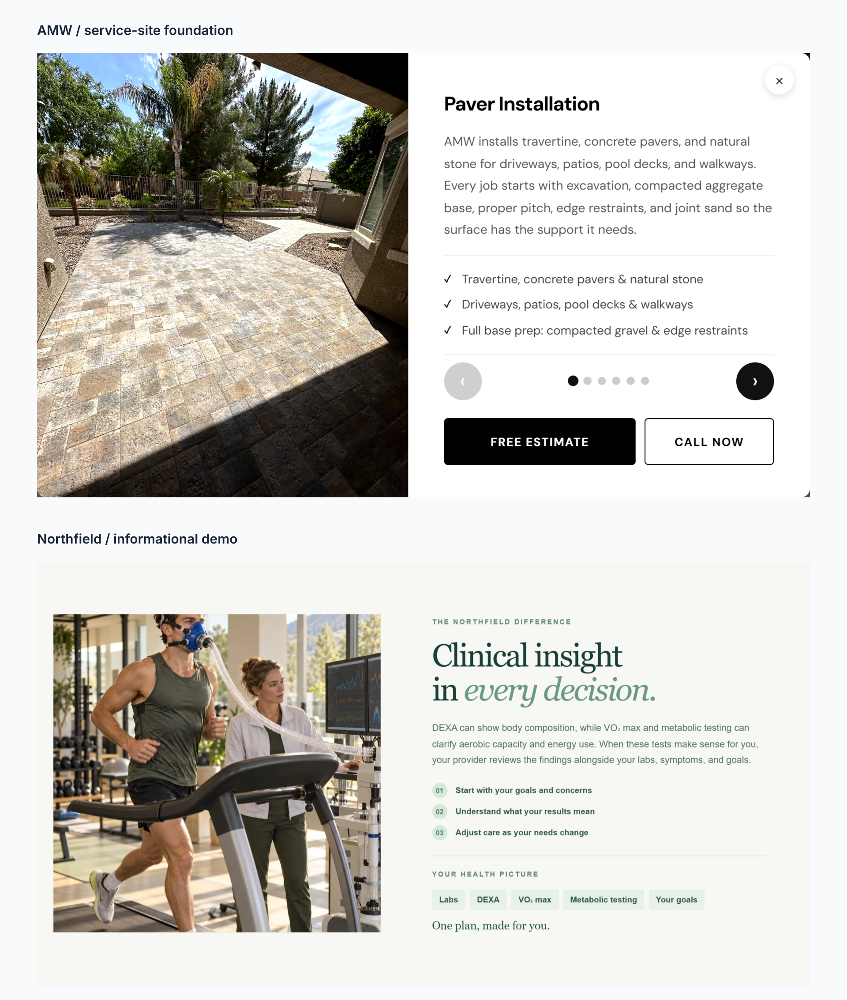

I was building design systems before anyone I worked with called them that. The first was a master email template. Later came a landing-page library, Shopify sections and the foundations I use for client sites.

Each started with a practical problem: too many campaigns to build individually, several brands sharing the same CMS, or a theme that couldn't handle the pages Marketing needed.

The useful part has always been the handoff. Someone else needs to understand the values, assemble the parts and make changes without having to reconstruct my decisions first.

## What I Mean by a Design System

I start with shared values for color, type, spacing and motion, then build components that use them. I also document their states, responsive behavior and content requirements. A card needs rules for a long title and a missing image, as well as its default appearance.

For marketing work, page composition matters too. The offer, supporting proof and next action need an order that suits the audience. I carry those decisions into the reusable sections so the next page has a sensible starting point.

I invest in the library when components repeat, several people will edit them, or the work has to survive a platform change. For a one-off page with one owner, a small set of shared styles may be enough.

## My Tokens, Plainly

Most of my work is web-first. CSS custom properties are usually enough for the shared values, with component styles keeping the implementation scoped.

On [this portfolio](/projects/personal-portfolio), for example, the button combines a shared font with a component-owned motion value:

```css
.button {
  --button-hover-lift: 2px;
  font-family: var(--font-primary);
}

.button:hover {
  transform: translateY(calc(-1 * var(--button-hover-lift)));
}
```

The themes supply different text, surface and accent values to the same components. Other rules, including some dimensions, live in the component stylesheet. The important thing is knowing where a value belongs and what changing it will affect.

The same separation shows up in a benefit card. Its surface, spacing and type follow repeated rules; its icon, heading and copy come from the content.



*An editable component study on the left, beside the captured AOP card on the right.*

## The Email Template That Started It

At Imagine Learning, campaign emails kept arriving with familiar requirements: a header, an offer, image-and-text rows, actions and a footer. I collected the variations in one commented [master email file](/projects/email).

A designer could copy a complete row, replace its content and retain the nested tables, gutters and alignment. The brand recipes explained which logo and colors to change.



*The gray boxes are the original template's image slots. Each mirrored row keeps the table structure around the replaceable content.*

These shared values were written into inline styles and HTML attributes. There were no CSS custom properties in the email. The platform called for a different implementation, so the editing notes and repeatable markup did more of the work.

## Master Blocks: Reuse Under a Deadline

A new marketing director wanted more landing pages, faster, across six product brands. Building each page from scratch wouldn't fit the schedule.

I proposed [Master Blocks](/projects/master-blocks): an HTML/CSS library the team could use in WordPress and a custom .NET CMS. CSS variables held the palette and font. Shared classes handled type sizes and spacing. Brand rules, core styles and campaign overrides had separate areas in the stylesheet.

Each section kept its wrapper, content and controls together. The team could duplicate a benefits block, move an image-and-text section or remove a module. Flexbox handled the rows and mobile stacking.



*The offer and form lead the LIFEPAC example; the introduction and benefits follow. These are sections assembled into a page, with a defined role for each.*

Earlier A/B tests and heatmaps informed that order. I put the strongest offer and form near the top for those campaigns, then used the remaining sections to answer questions and support the decision. I'd review that order again when the audience or offer changed.

The system reduced landing-page production time by 40% across more than 50 pages. It also gave Marketing something they could edit in the tools they already used.

## Shopify: Carrying the Library Across Themes

For [AOP and Ignite Christian Academy](/projects/shopify-migrations), I built Liquid sections with schema settings for content, media, layout, spacing and actions. Marketing could configure those settings in Shopify's theme editor.

The section families carried across both migrations, with integration work for Kalles on AOP and Horizon on Ignite. I kept the custom marketing work in its own sections to limit changes to the base theme. Theme updates still needed checking against that integration.



*The tab section supports text or icon navigation and horizontal or vertical arrangements. The content blocks keep the same basic fields across those variants.*

[Try the working tab study](/demo/shopify/tabs/index.html) to change its layout and icons or move between subjects with the keyboard.

Ignite also needed custom product-detail and collection templates, navigation and a footer. After handoff, the client designers and marketers chose the final artwork, copy, page order and brand treatment.

## Top Web Works: Choosing the Right Starting Point

I now use [three systems at Top Web Works](/projects/topwebworks): customized Tailwind UI for the agency site, a service-site library and an informational-site library.

AMW Hardscape uses the service foundation. Its project photos, service details and estimate actions help a homeowner assess the work and ask for a quote. The fictional Northfield Health demo uses the informational foundation, with goal selection, explanations and a longer introduction to the people and process.



*AMW is a finished client site. Northfield is a fictional demo. The two modules show why I keep separate starting components for these kinds of sites.*

Within each foundation, clients get their own branding, content and page order. I can put a working homepage in front of an owner early, then use their feedback to finish the site. The shared code leaves more time for the choices specific to that business.

## Working From an Approved System

Once a component and its visual rules are approved, I can explore a variation directly in the browser. Moving, duplicating or removing a block shows how the real layout responds. A working prototype also exposes behavior that a static comp can leave unresolved.

When feedback happens in Figma, I'll bring in screen grabs and annotate the changes there. I used that approach with Master Blocks when Marketing needed a Student Program concept: I assembled it from the existing blocks, then reviewed revisions through screenshots and notes.

Approved styling still leaves interaction decisions to check. I review keyboard focus, validation, loading and error states, and the smaller layouts before calling a new version ready. A new product or visual direction needs its own exploration and review.

## What I Want the Next Person to Know

The files should tell someone which values to use, which pieces to combine and what to check before publishing. As features change, the components and their documentation need to move together. That's the standard I try to meet when I hand a system over.
