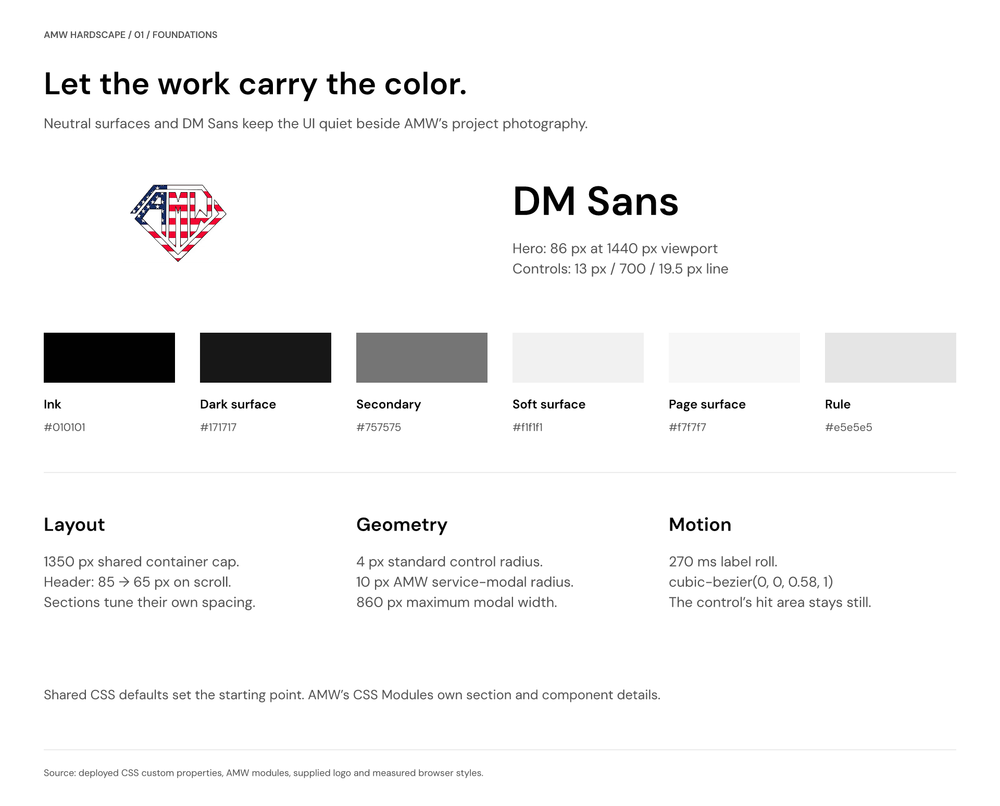
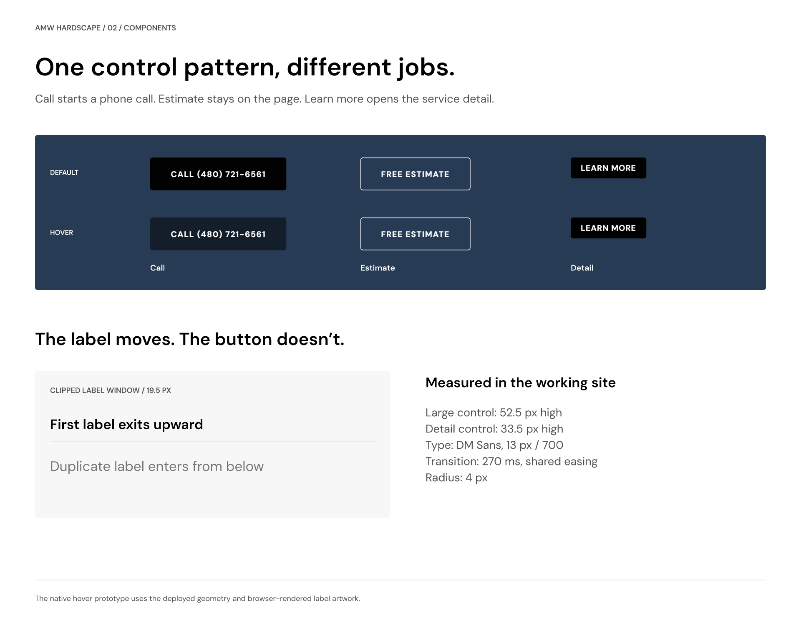
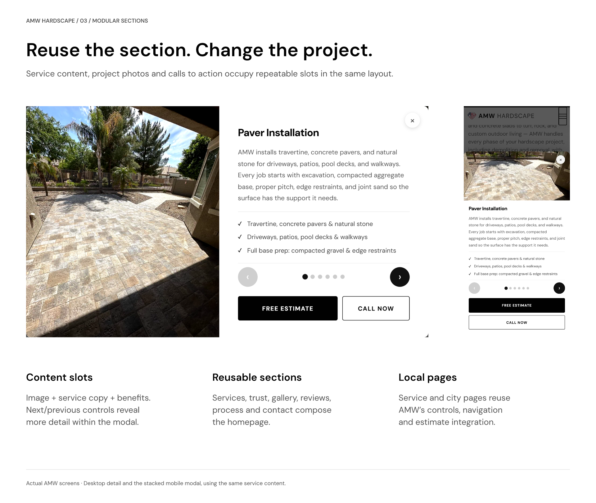
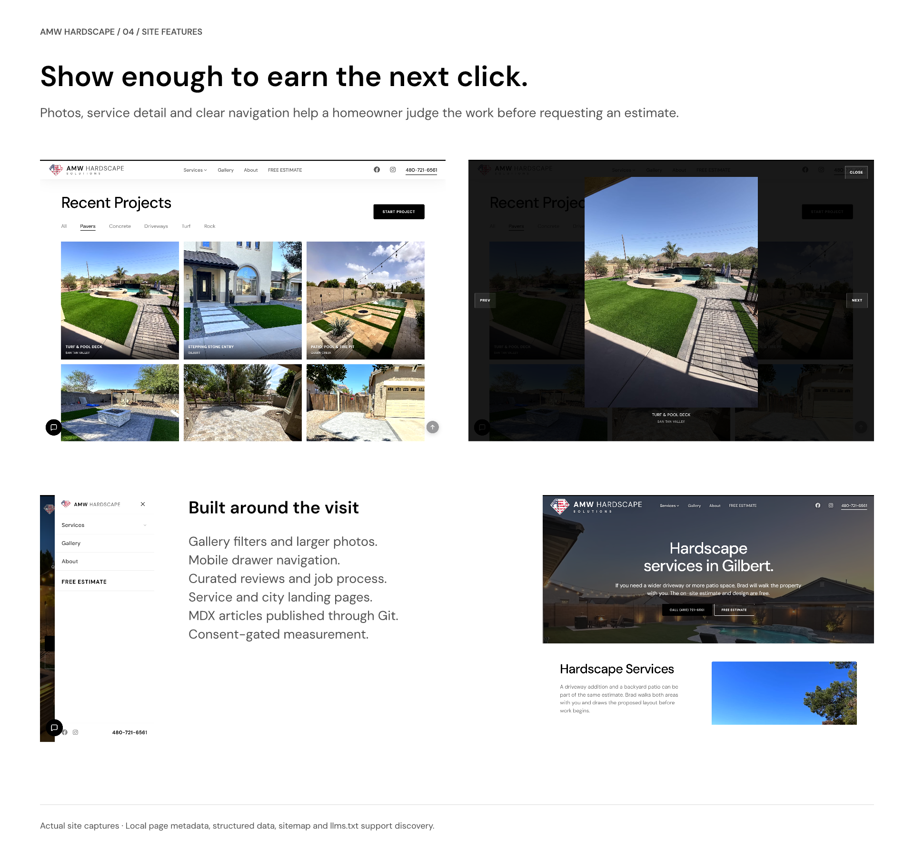
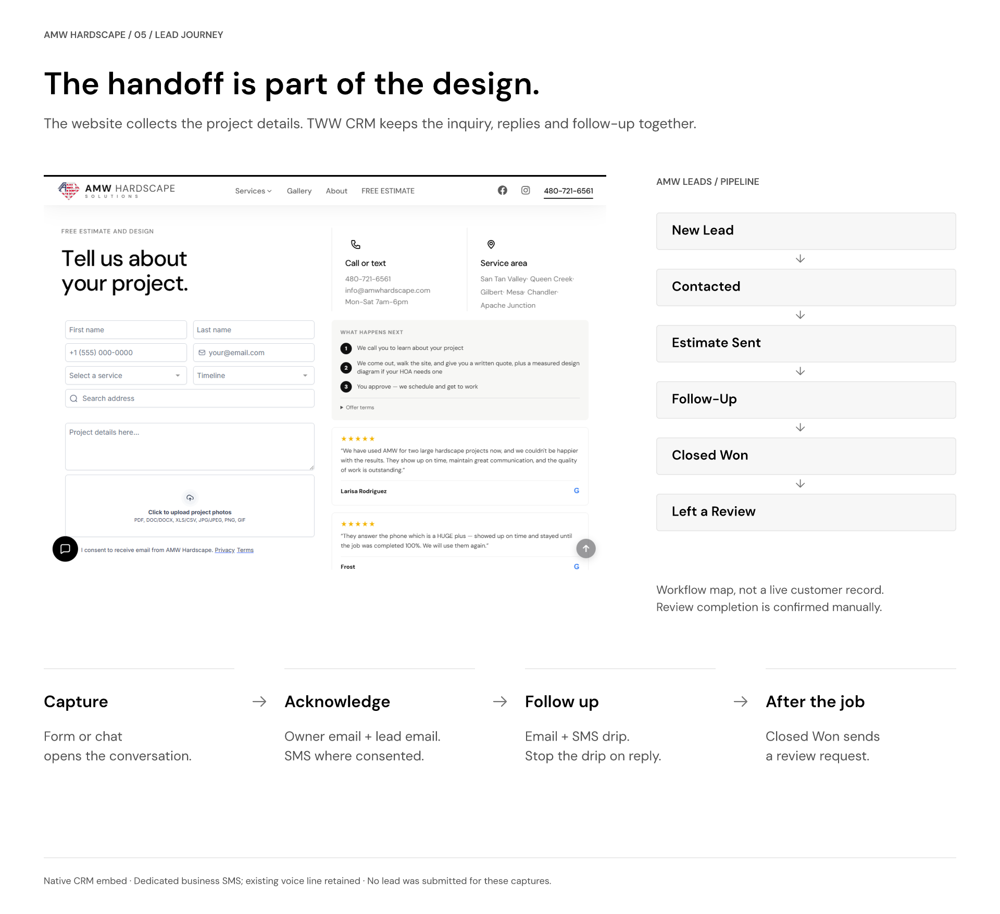
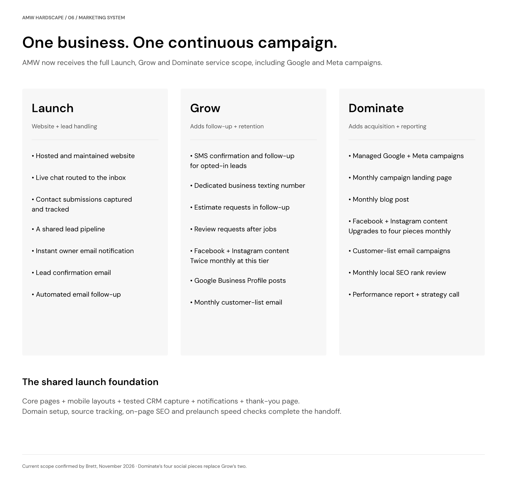

## The Brief

I built and maintain AMW Hardscape Solutions' website and marketing for Brad, a licensed contractor serving Arizona's East Valley. The site needs to show the quality of his work, help a homeowner understand the service and make the next step clear.

That work extends past the website. I also manage the lead pipeline, follow-up, review requests, local search, content, email and paid campaigns through Top Web Works.

## Tokens That Reach the Interface

AMW uses my Top Web Works site foundation, with custom React sections and CSS Modules for its own content and behavior. Shared CSS properties set the typeface, neutral colors, container width, radii and motion. Component styles handle the details.

DM Sans and a mostly black-and-white interface leave room for the project photos. The standard control radius is 4 px; the service modal uses 10 px. The header shrinks from 85 to 65 px on scroll. These are working interface values, carried into the design documentation.

## Controls With a Clear Job

The hero offers two routes. Call opens the phone dialer. Free Estimate scrolls to the form. Learn More opens a service detail without sending the visitor away from the homepage.

The controls share a label-roll animation: one copy leaves through a clipped window while another enters from below. The transition takes 270 ms; the button's hit area stays put. Large actions and compact detail buttons keep their own padding and height.

## Sections That Can Be Reused

The homepage is assembled from service, trust, gallery, review, process and contact sections. Each has a defined role in helping someone assess AMW and request an estimate.

The service section covers pavers, concrete, driveways, decorative rock, artificial turf and custom outdoor work. Photos, copy and benefits fill reusable slots. The detail modal has its own next/previous controls, plus estimate and call actions. On mobile, its image and content stack vertically.

Service and city pages reuse the navigation, controls and estimate integration. They give a search visitor a more specific starting point without requiring a separate visual system for every page.

This recording shows the live controls, service detail, project filter, image viewer and estimate section.

<video controls playsinline preload="none" poster="/demo/amw/amw-workflow-poster.webp" width="1280" height="900">
  <source src="/demo/amw/amw-workflow.mp4" type="video/mp4">
  <a href="/demo/amw/amw-workflow.mp4">Watch the AMW website interaction recording.</a>
</video>

## Give Visitors Enough to Decide

The project gallery filters by service and opens larger photos. Curated Google reviews, licensing information and the job process support the work on display. A mobile drawer keeps the navigation available on smaller screens.

Local service pages and MDX articles provide room for more specific questions. Git-based publishing, page metadata, structured data, a sitemap and llms.txt support discovery. Cookie consent controls analytics and advertising measurement.

## Carry the Inquiry Through

The estimate form asks about the service, timing and project, with an option to upload photos. Nearby copy explains what happens next. I use a native TWW CRM embed, configured to fit AMW's presentation, rather than building a second form-processing system.

Submissions enter the AMW Leads pipeline. Brad receives an email notification, and the lead receives confirmation and follow-up. Opted-in leads also receive SMS confirmation and follow-up through a dedicated business texting number. AMW keeps its existing voice line. Live chat gives visitors another way to start a conversation.

The email and SMS drip stops when the lead replies. Estimate requests stay in the follow-up, and the pipeline tracks progress through contact, estimate, follow-up and completion. Closed Won triggers a review request. Review completion is confirmed manually; the testimonials displayed on the website are curated separately.

## Keep the Marketing Connected

AMW now receives the full Launch, Grow and Dominate service scope from Top Web Works.

Launch covers hosting and maintenance, chat routed to the business inbox, tracked contact submissions, the lead pipeline, instant owner notifications, lead confirmation and automated email follow-up.

Grow adds consent-based SMS, the business texting number, estimate requests in follow-up and review requests after jobs. It also includes Google Business Profile posts, a monthly customer-list email and twice-monthly Facebook and Instagram content.

Dominate brings managed Google and Meta campaigns, a monthly campaign landing page and blog post, customer-list email campaigns, monthly local SEO tracking, a performance report and strategy call. Social content increases to four pieces a month across Facebook and Instagram.

I carry the campaign's service and message from the ad into the landing page, email and follow-up. The underlying build includes the core pages, mobile layouts, tested CRM capture, notifications, a thank-you page, source tracking, domain setup, on-page SEO and prelaunch speed checks.

[Visit AMW](https://www.amwhardscape.com), [download the design system PDF](/demo/amw/amw-design-system.pdf), or explore the [component artwork](/demo/amw/controls.svg), [tokens JSON](/demo/amw/tokens.json) and [tokens CSS](/demo/amw/tokens.css).
