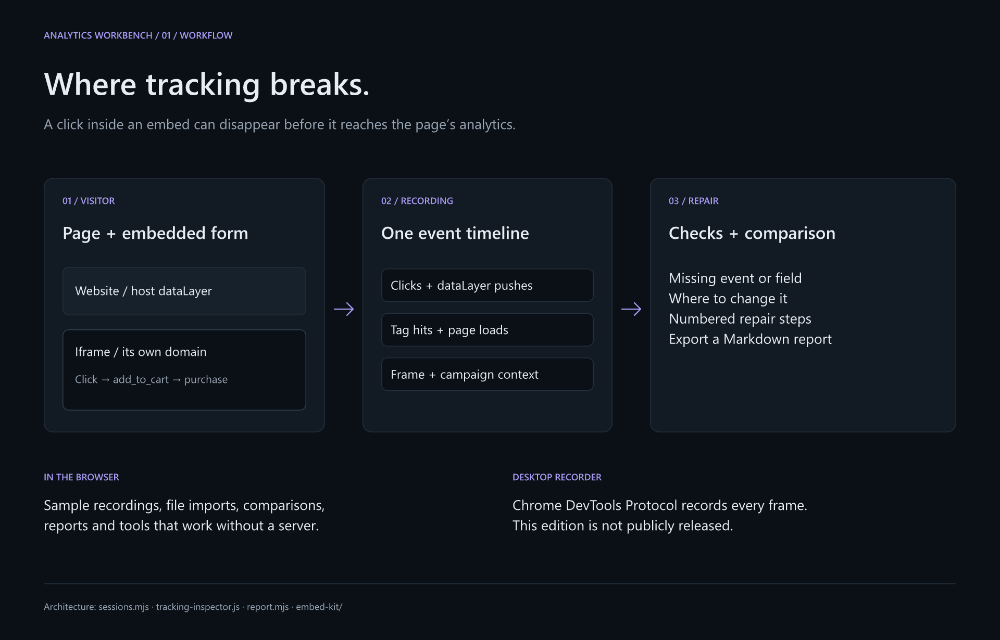
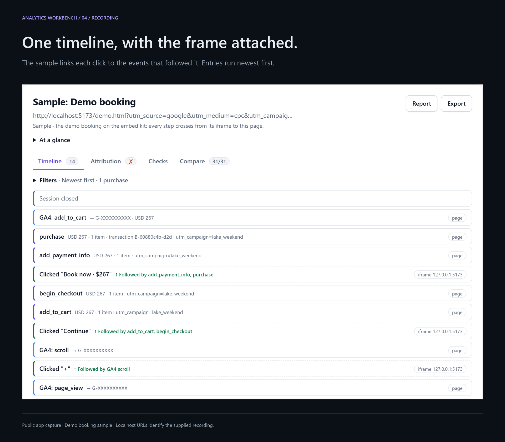
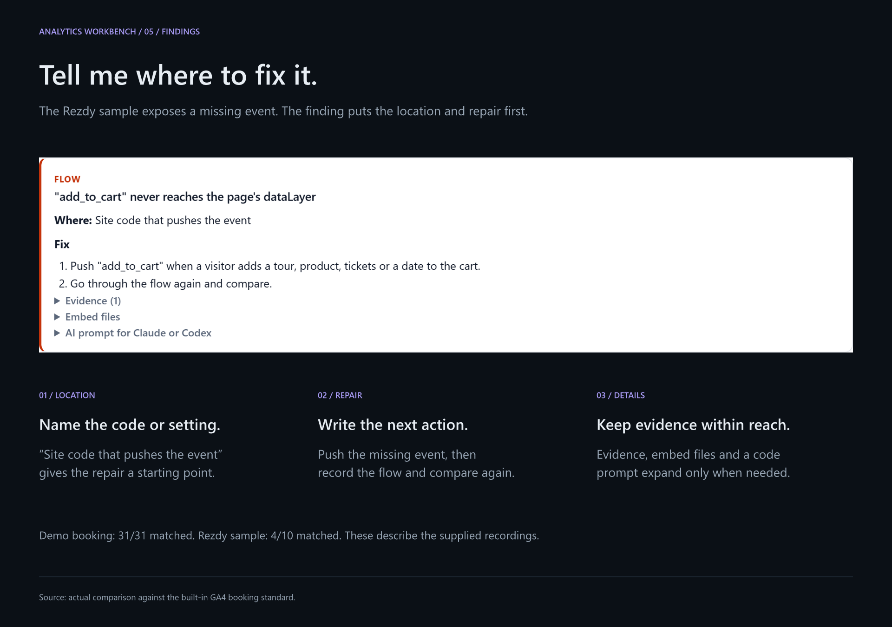
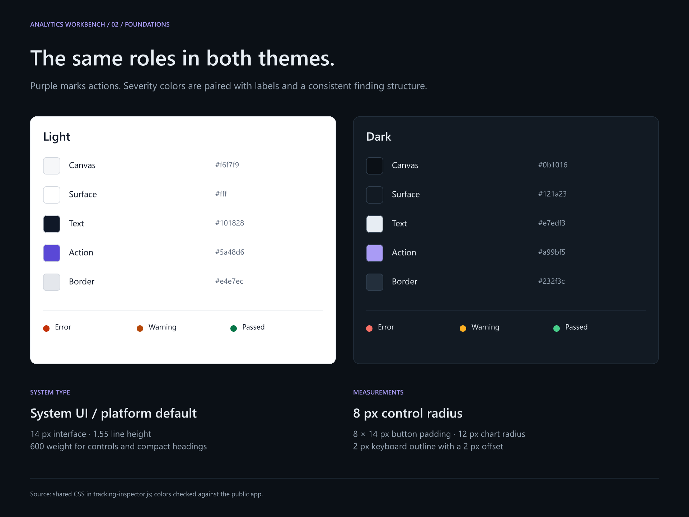
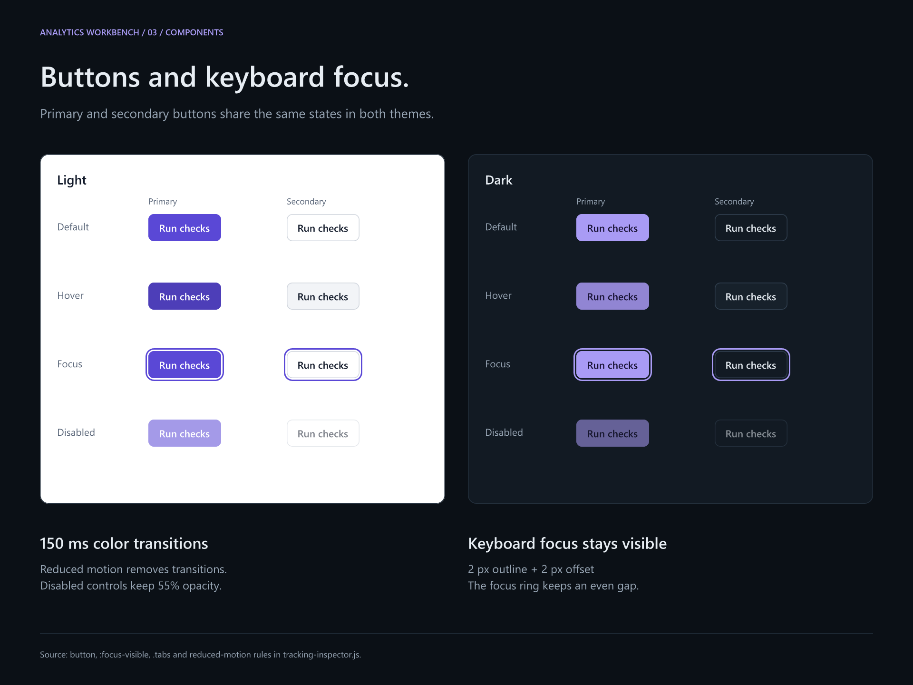
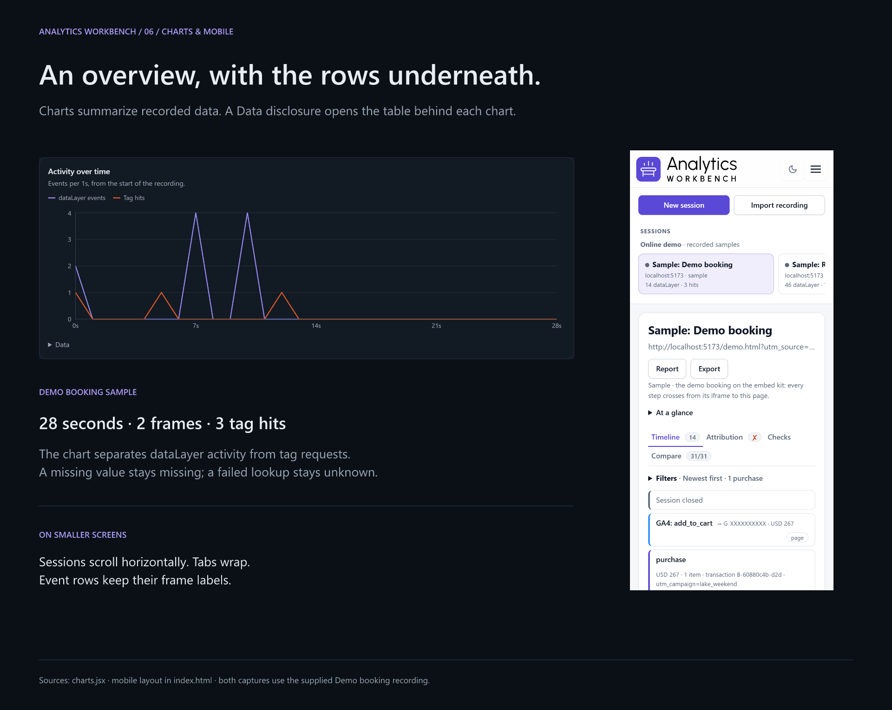

## The Brief

An embedded checkout can finish a sale while the website's analytics misses it. The page and iframe have separate data layers, and campaign details do not always cross that boundary.

I built Analytics Workbench to follow that handoff. It brings clicks, dataLayer pushes and tag requests into one recording, checks what arrived, and gives the person fixing it a place to start.

## One Timeline

Each row keeps its frame label. A click shows the events or tag hits that followed within a second and a half, making a dead end easier to spot. Filters narrow the recording without losing the surrounding session.

The desktop recorder runs Chrome through the DevTools Protocol, with a recorder in every frame. The browser edition can inspect saved recordings and use a bookmark recorder for the current page; full cross-origin recording needs the desktop edition.

## From Finding to Repair

I put the location and numbered fix steps before the supporting detail. Evidence, embed files and a coding prompt stay in disclosures, so a long report does not bury the next action.

Compare checks a recording against the built-in GA4 booking standard, another session or an imported reference. The supplied Demo booking sample matches 31 of 31 checks. The Rezdy sample matches 4 of 10 and exposes missing events and purchase fields. Those counts describe the samples, not a customer's tracking health.

This recording moves from the matching sample to the incomplete one and opens the evidence behind a finding.

<video controls playsinline preload="none" poster="/demo/analytics/analytics-workflow-poster.webp" width="1280" height="800">
  <source src="/demo/analytics/analytics-workflow.mp4" type="video/mp4">
  <a href="/demo/analytics/analytics-workflow.mp4">Watch the sample comparison and repair workflow.</a>
</video>

Reports download as Markdown. The embed kit supplies the other half of the repair: one script sends standard events from the iframe; the host script checks the message origin and frame before pushing them into its dataLayer. The booking demo uses that kit.

## Foundations

Shared CSS defines the canvas, surfaces, text, borders, actions and severity colors. Both themes use those roles. The interface uses the platform's system font, with compact labels and tabular figures in the data tables.

[Download the token JSON](/demo/analytics/analytics-tokens.json) or [view the CSS](/demo/analytics/analytics-tokens.css).

## Controls and Feedback

Buttons change color over 150 milliseconds. They keep their position and size. Keyboard focus uses a two-pixel outline with a two-pixel gap; disabled controls fade to 55% opacity.

[Open the vector control board](/demo/analytics/control-states.svg).

New timeline entries briefly hold an amber highlight, then fade. Old recordings do not replay it. Reduced motion removes the arrival animation and control transitions.

## Charts and Smaller Screens

The session overview separates activity by time, event, platform and frame. Each chart has a Data disclosure for its table. Search and page-speed tools use the same pattern, with the source and coverage stated beside the results.

On mobile, sessions scroll horizontally, tabs wrap, and event rows retain their frame labels.

## Beyond Tracking

- **Site tools** check campaign links, email records, DNS, security policy, server-side tagging, site basics and page speed.
- **Search and AI tools** work with Search Console, Keyword Planner and GA4 exports, alongside page checks and sourced observations. They do not invent rankings, search volume or AI visibility scores.

Testing on 11 sites exposed false positives in the early checks. Minified code could look like a broken dataLayer, and a blocked page could look like a failed audit. I changed the rules to require runtime evidence for a reset and to report blocked access as a limit on the check.

## Try It

[Open Analytics Workbench](https://analytics.rockitcode.com/) to inspect the samples, import a recording, compare events or download a report. The desktop recorder is not publicly released.

No account is required. Saved recordings stay in browser storage, and optional site analytics follows the visitor's cookie choice.

[Download the design system PDF](/demo/analytics/analytics-system-overview.pdf).
