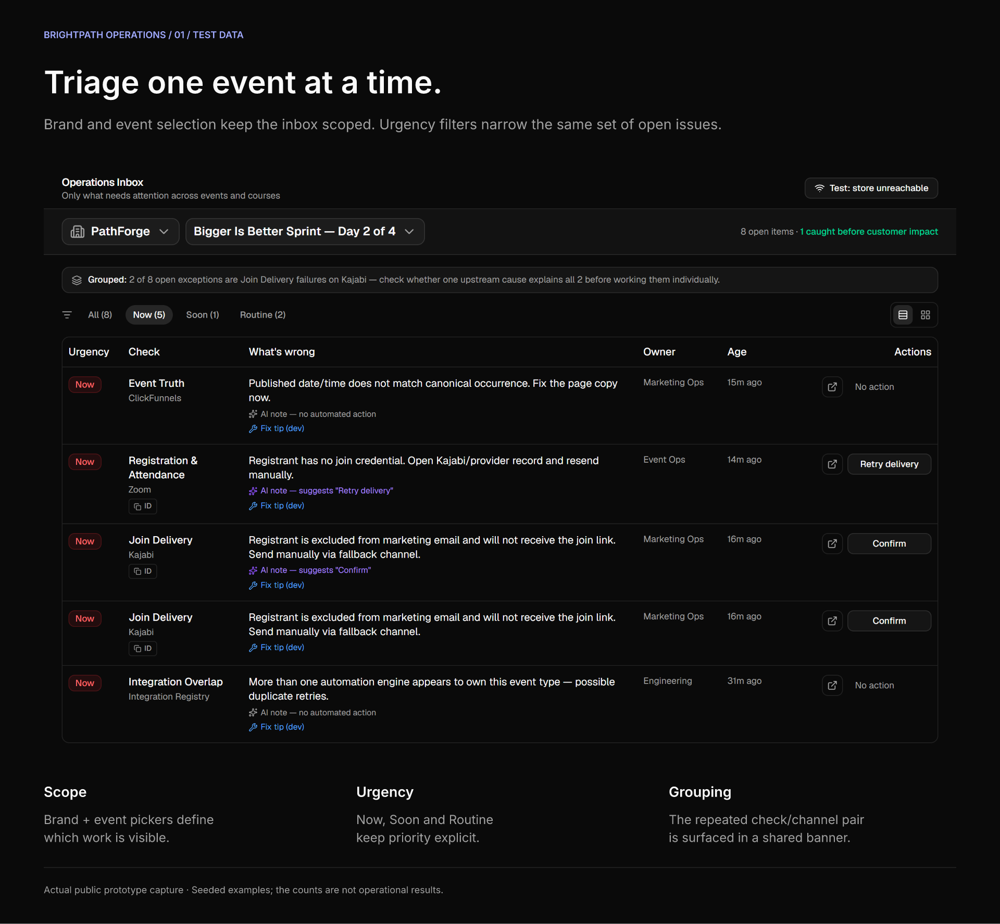
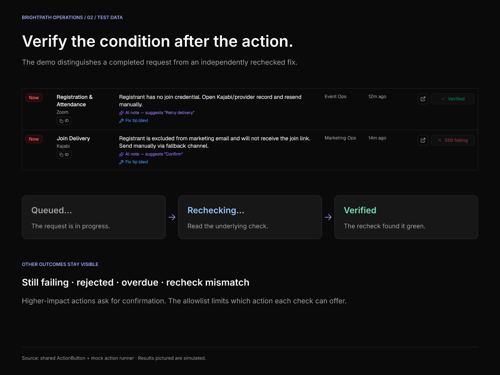
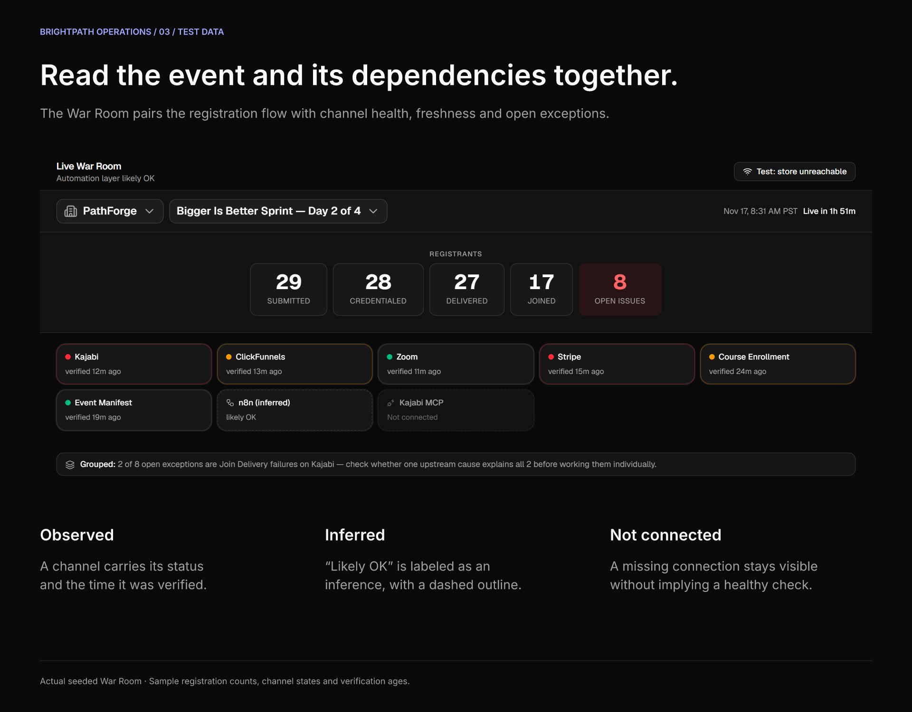
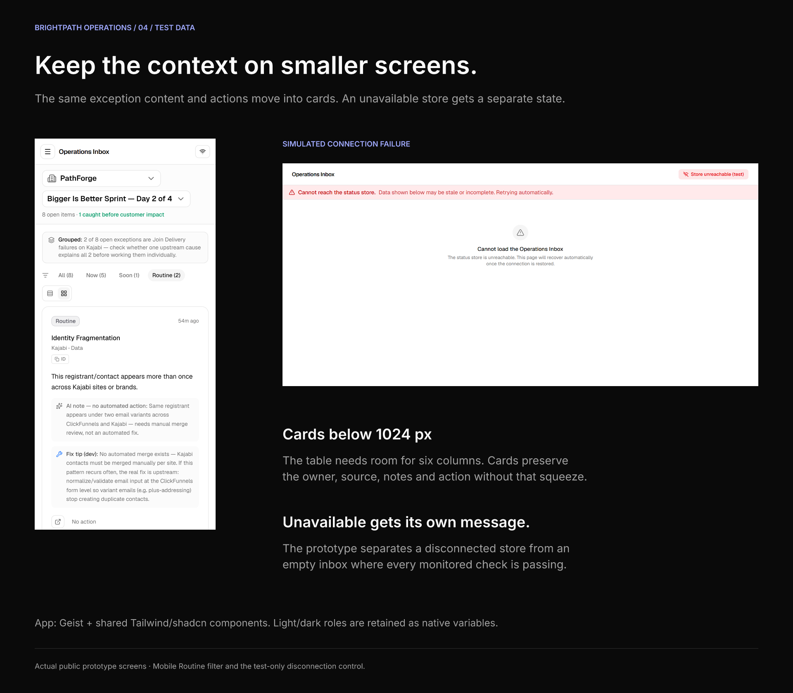

## The Brief

I built this as a prototype for an internal operations tool. The company and brand names have been changed for this demo.

The problem was keeping track of an event across several platforms: registrations in one place, join credentials in another, reminders and automations somewhere else. I wanted an operator to see which exceptions needed attention and what they could do next.

The public prototype runs on test data. Its notes, counts and action results are seeded examples; no customer systems are connected.

## An Inbox for One Event

The brand and event pickers define the scope. Now, Soon and Routine filters narrow the open issues, while each row keeps the source, owner, age and available action together.

A grouping banner highlights repeated check types within one channel as a possible shared cause. Two delivery failures can then be investigated together before someone works through them individually.

## What Happened After the Click?

I gave action requests several visible outcomes. A queued request becomes overdue if it takes too long. A response that reports success triggers a separate health-check read before the interface shows Verified.

Still failing, rejected and a recheck mismatch have their own states. Higher-impact actions ask for confirmation, and each check has an allowed set of actions.

This recording shows the urgency filter, table/card switch and two simulated action outcomes.

<video controls playsinline preload="none" poster="/demo/brightpath/brightpath-workflow-poster.webp" width="1280" height="900">
  <source src="/demo/brightpath/brightpath-workflow.mp4" type="video/mp4">
  <a href="/demo/brightpath/brightpath-workflow.mp4">Watch the prototype interaction recording.</a>
</video>

The triage notes illustrate the intended assistant experience: explain the likely cause and suggest a next step. They are supplied with the demo data. Drafted next-step text can be edited or marked as reviewed; reviewing it does not execute an action.

## The War Room

The War Room puts the registration flow above the channel health strip. Submitted, credentialed, delivered and joined counts give the event a quick overview, with open exceptions below.

Status and freshness stay separate. A failed check can have a recent verification time. An inferred state says “likely OK” and uses a dashed outline; an unconnected source stays visible.

## Shared Content, Different Layouts

The table works where there is room for six columns. Below 1024 pixels, cards keep the same exception content and action behavior. A manual view switch lets someone choose either layout.

I used Geist with shared Tailwind and shadcn components. Light and dark themes share the same roles for surfaces, text and borders. Table rows and cards reuse the exception body and action component, so feedback stays consistent.

A disconnected store gets a clear error state. An inbox with no failing checks has a separate “Nothing needs attention” message.

## Supporting Screens and Scope

Pricing Governance and Access Review show policy and permission exceptions with a next step. Playbooks connects the checks to the wider operating procedures.

The data source and action runner currently use mock implementations. Connecting live providers is a separate phase.

[Try the prototype](https://nextjs-nr-ops.vercel.app), [download the interface notes PDF](/demo/brightpath/brightpath-interface-notes.pdf), or [open the vector action board](/demo/brightpath/action-states.svg).
