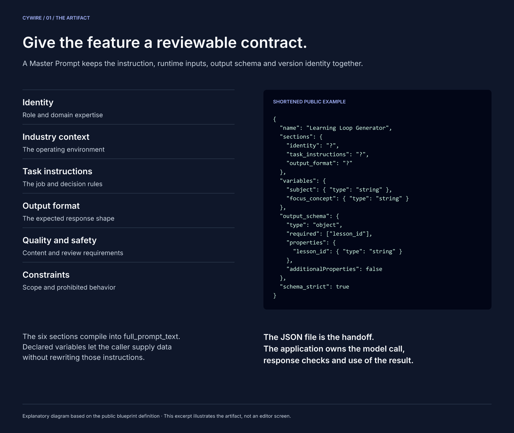
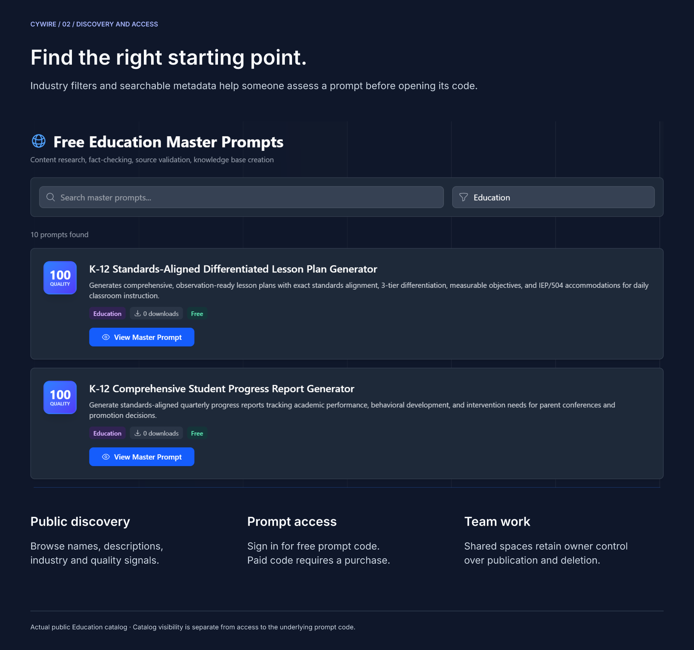
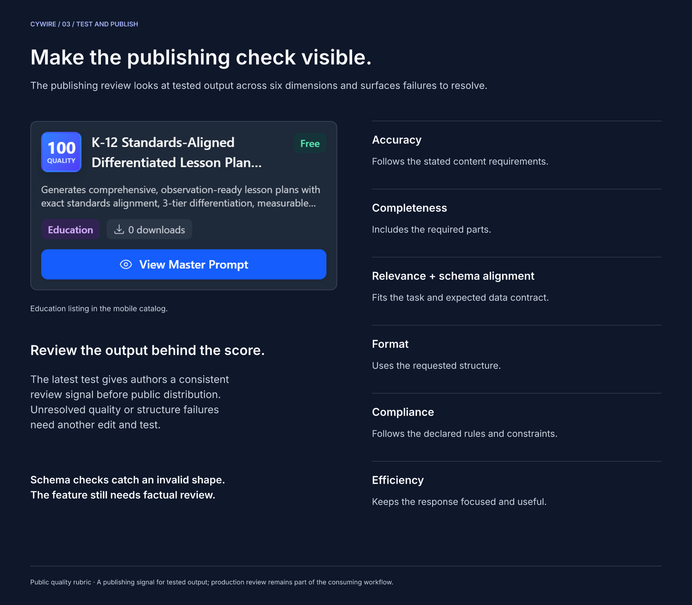
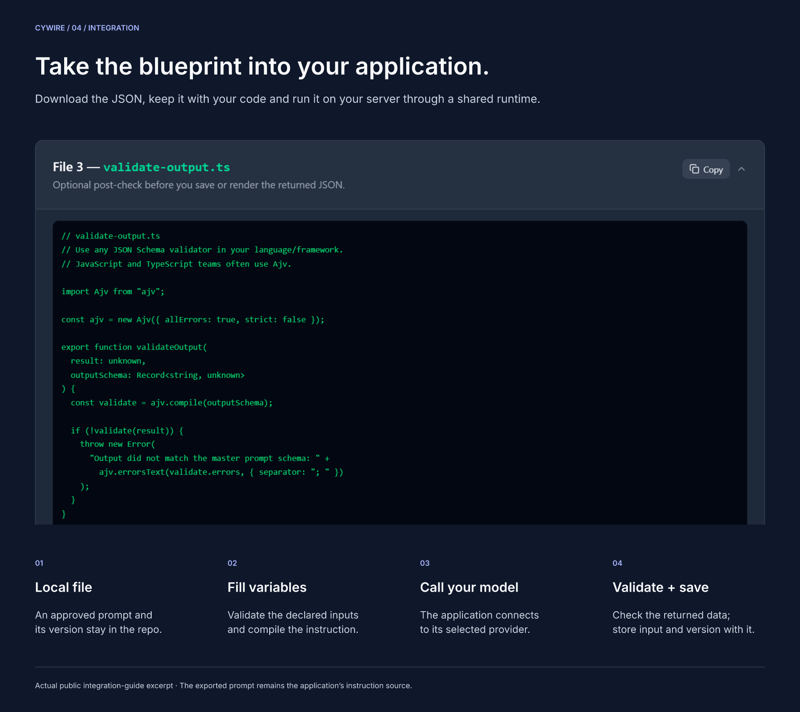
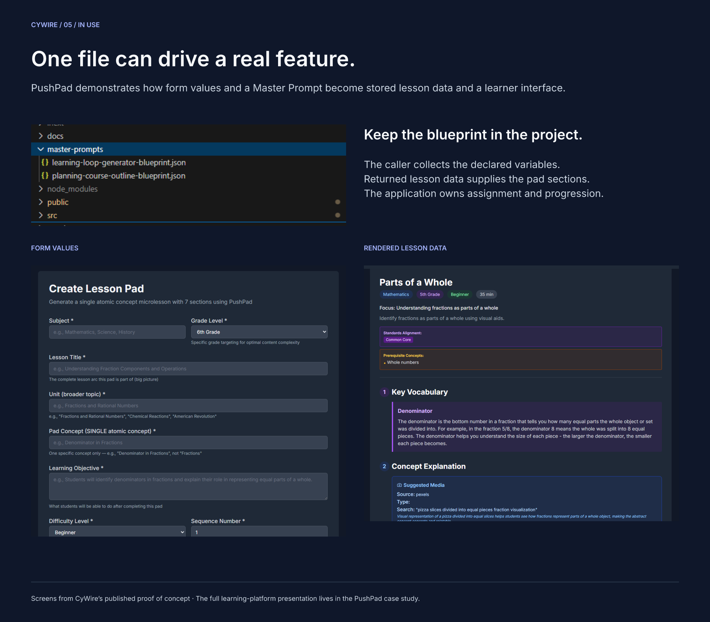

## The Brief

I built CyWire to make Master Prompts easier to create, review, test and hand off. A Master Prompt packages a feature's instructions, declared inputs, output schema and version information in a JSON file.

The product gives authors a workspace for that file and developers a defined artifact to integrate. The application team connects it to their chosen model, checks the response and decides how the returned data is used.

I designed and implemented the platform, including its authoring tools, prompt library, publishing workflows, team permissions and marketplace.

## Make the Structure Editable

Long instructions are difficult to maintain when the rules, sample values and expected response are mixed together. I wanted an author to be able to inspect those parts separately and understand what a change would affect.

The builder organizes six instruction sections: Identity, Industry Context, Task Instructions, Output Format, Quality and Safety, and Constraints. Typed variables declare the inputs that can change. The output schema describes the data the consuming feature expects.

The visual editor and JSON representation work on the same blueprint. Its sections compile into the full instruction text; runtime values fill the declared variables. Published versions are snapshots, so later edits can be identified separately from a version already used by an application.

## Help People Find a Useful Starting Point

The library separates private work, team-shared material, free community prompts and marketplace purchases. Those distinctions affect what someone can open, edit and publish.

Public catalogs expose the information needed to assess fit: the task, industry, description and quality signal. Filters narrow the list, while server-rendered pages and real pagination links make it possible to browse without loading the whole catalog at once. Opening free prompt code requires an account; paid code requires a purchase.

A marketplace purchase delivers the listed snapshot as an editable private version. The buyer's changes and version history develop independently from the publisher's original. Later publisher edits don't overwrite their customizations.

## Show What Needs Another Test

Testing is part of the publishing workflow. The review examines the latest tested output across accuracy, completeness, relevance and schema alignment, format, compliance with declared rules, and efficiency. Unresolved failures need another edit and test before publication.

I wanted the result to give an author something to act on. A quality score is useful when it points back to the output and the requirement that was missed. Schema validation checks the shape of the data; the consuming feature still needs tests for factual correctness and the rules of its domain.

The free community and marketplace have separate moderation paths.

## Keep the Handoff in the Application

The integration starts with a downloaded JSON file in the project's master-prompts folder. A shared runtime loads that file, validates the declared inputs and compiles the instruction. The application's server makes the model call.

The guide separates those jobs into small files: prompt.ts loads the blueprint and prepares its variables; runner.ts handles execution; validate-output.ts checks the returned shape; prompt-registry.ts keeps file references in one place.

Saving the prompt filename, version, input and returned JSON together gives a developer a way to trace a stored result after the blueprint changes. The exported artifact remains inspectable in the project rather than disappearing into an account setting.

This recording expands the public guide's runtime examples and shows where validation and saved-result traceability fit.

<video controls playsinline preload="none" poster="/demo/cywire/cywire-integration-poster.webp" width="1280" height="900">
  <source src="/demo/cywire/cywire-integration.mp4" type="video/mp4">
  <a href="/demo/cywire/cywire-integration.mp4">Watch the CyWire integration-guide walkthrough.</a>
</video>

## Put It to Work in PushPad

[PushPad](/projects/pushpad) gave me a practical application for this approach. Form values supply the variables for lesson generation. Returned lesson data is stored and rendered into the pad's sections, with the learning platform handling assignments and progression.

CyWire's published proof of concept follows that handoff from local blueprint files to an input form and a rendered lesson. It makes the boundary tangible: the prompt defines the content contract, and the application turns the returned data into an experience someone can use.

## Build the Workspace Around the Artifact

The platform uses Next.js, React, TypeScript, Tailwind and Supabase. Shared interface patterns carry through the authoring, library and account flows. Organization owners control publication and deletion, while members contribute within their workspace permissions.

A document-backed knowledge base supports PDF, Word and Excel reference material. Labs includes a Chat Prompt Generator for adapting a Master Prompt to use in a chat tool.

The design work was keeping the views and states in agreement: what an author edits, what a developer downloads, which version a test refers to and what an account is allowed to open.

[Browse free Master Prompts](https://cywire.com/community/master-prompts), [read the integration guide](https://cywire.com/docs/integration), or [download the platform notes PDF](/demo/cywire/cywire-platform-notes.pdf).
