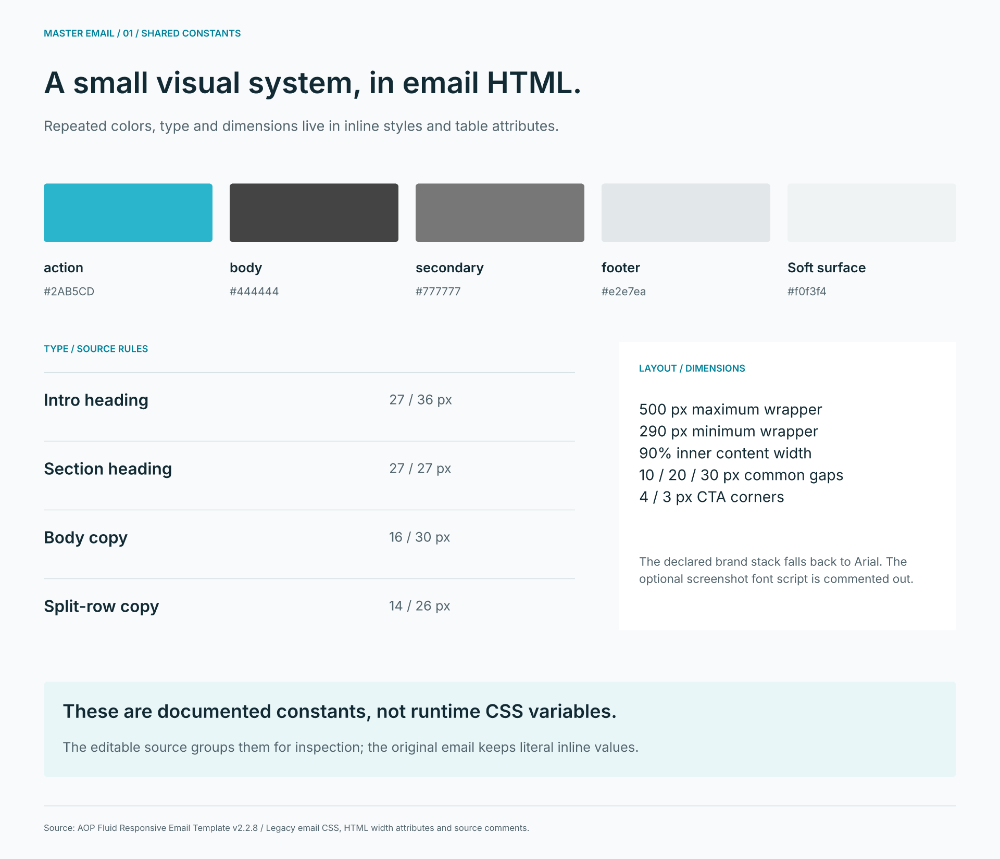
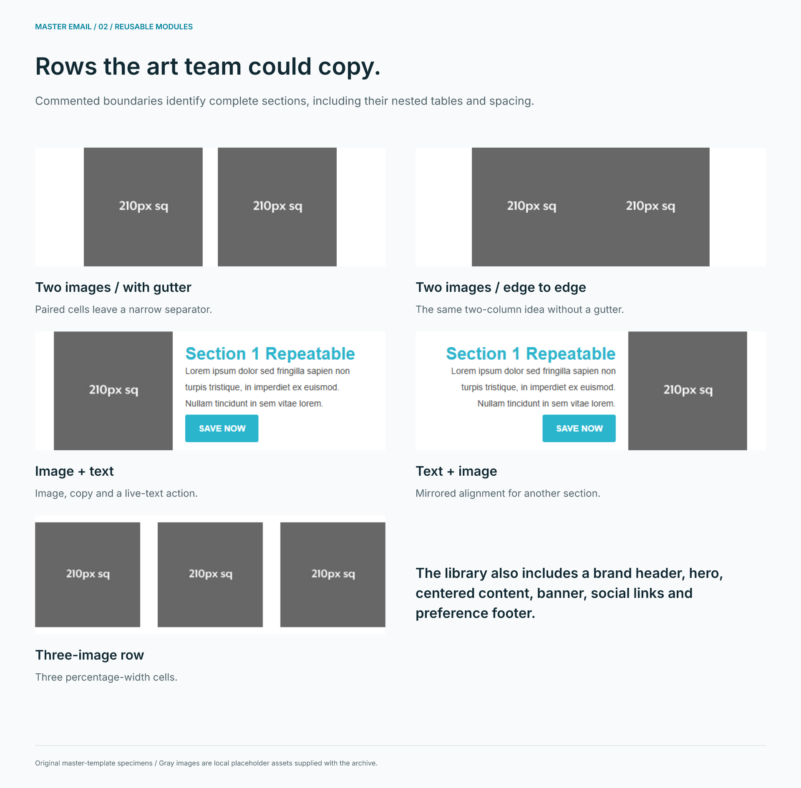
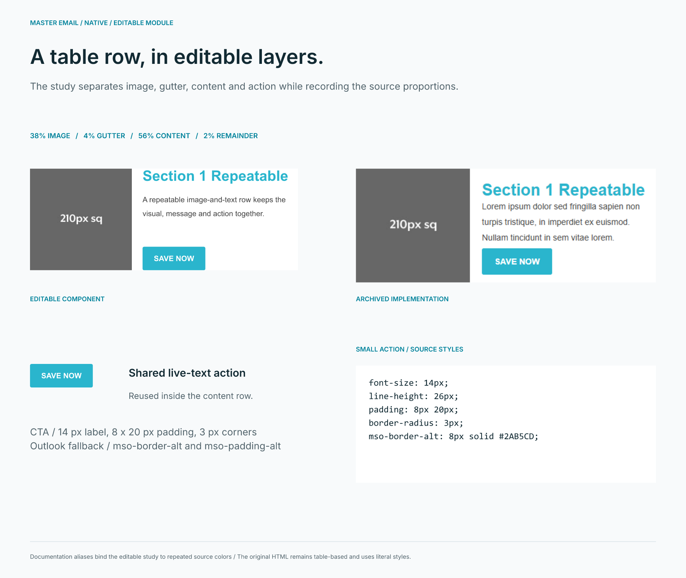
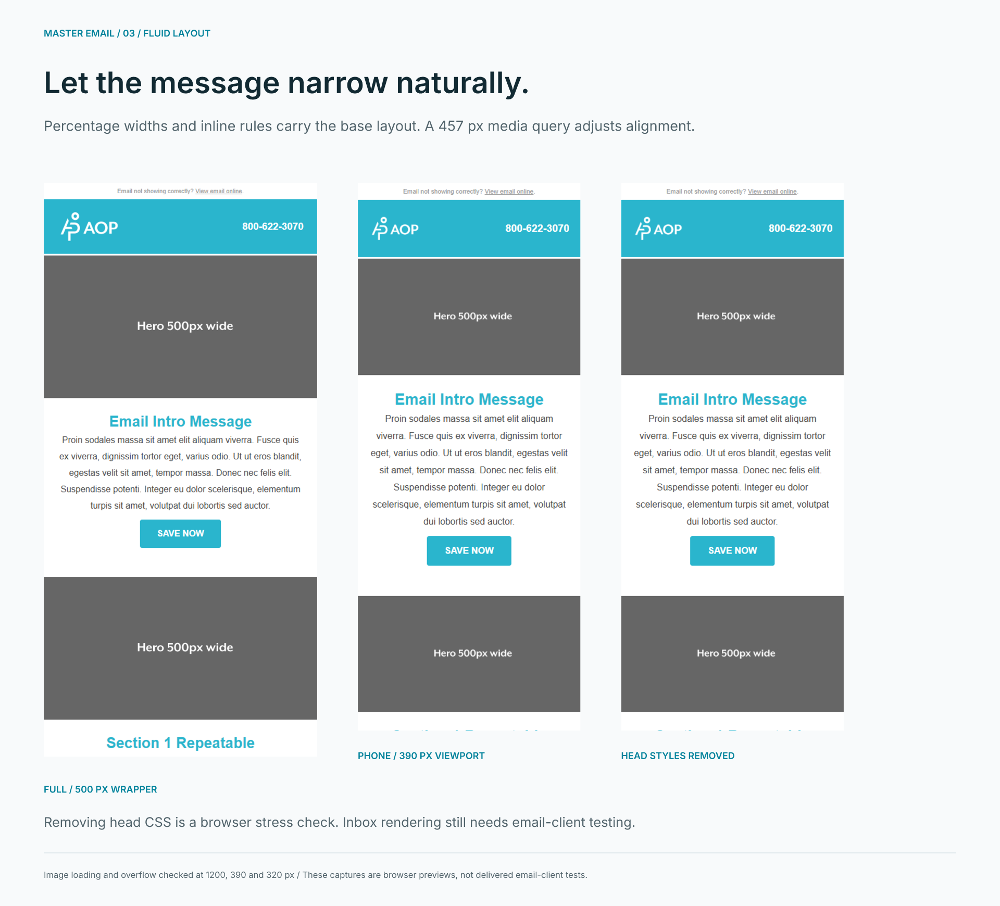
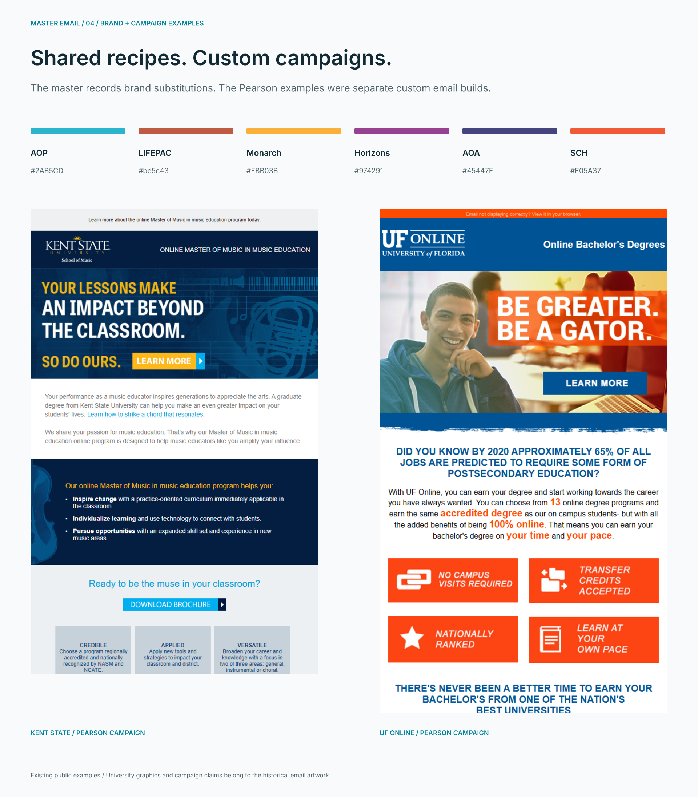
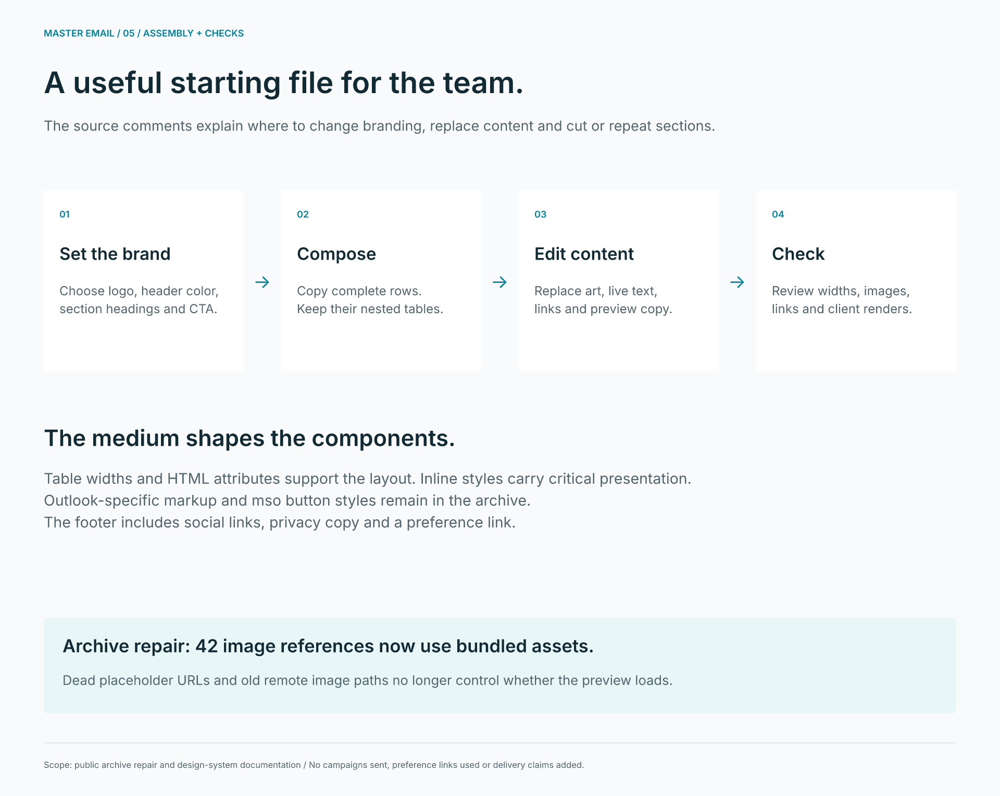

## One starting file

I built a master HTML email template for the art department to pull from. Each campaign needed its own offer and branding, but the team kept rebuilding familiar structures: headers, image rows, text sections, buttons and footers.

The template collected those pieces in one commented file. A designer could copy a complete section, replace the content and keep the surrounding layout intact. I handled the HTML/CSS, fluid layouts, brand options and editing notes.

For this case study, I worked back through the source to document the shared values and modules. The original template and two custom Pearson Online Learning emails are available below.

## The shared style values

The master repeats a small palette: cyan for headings and actions, dark gray for copy, and two pale gray footer surfaces. Its type rules distinguish the introduction, section headings, body copy and smaller image-and-text rows.

The wrapper has a 500 px maximum and a 290 px minimum. Most text sits inside a 90% content area. Spacing comes from table-cell heights, padding and spacer images.

These values are written directly into inline styles and HTML attributes. The [style snapshot](/demo/emails/design-system-tokens.json) collects them for inspection; the original email has no CSS custom properties.

## Reusable rows

The library includes a brand header, hero, introduction, live-text action, centered content, paired images, three-image rows, mirrored image-and-text sections, a banner and the footer.

I put comments around the sections and smaller editing points. Those boundaries helped the team copy a whole row, including its nested tables and gutters.

The image-and-text row divides its width between a 38% image cell, 4% gutter, 56% content cell and a small remainder. Its action uses a 14 px label, 8 x 20 px padding and 3 px corners. The larger introductory action has its own 16 px label and 4 px corners.

## Working within email constraints

I used percentage widths and inline presentation for the base layout. A small media query adjusts alignment below 457 px. Outlook conditional markup and Microsoft-specific button styles sit alongside the regular HTML.

Removing the head styles tests how much of the layout survives on inline styles alone. I checked the archive in browsers at desktop and phone widths; delivered rendering in Outlook, Gmail and other clients still needs separate testing.

## Brand choices and custom work

The source includes recipes for AOP, LIFEPAC, Monarch and other product brands. They identify which logo and colors to change across the header, headings and actions.

The Kent State and UF Online emails were custom builds for Pearson Online Learning. They show how campaign artwork and content could call for a different composition. Those builds took longer than starting with the master.

## Editing and keeping the archive usable

The handoff notes cover branding, image folders, replaceable content and sections that can be removed or repeated. Live text, working links and the preference footer need the same attention as the artwork.

I repaired 42 image references in the master preview. They now use the bundled logos, social icons and placeholder artwork instead of old remote paths and a dead placeholder service. The gray images are intentional layout specimens. I also marked layout tables as presentational and gave decorative spacers empty alt text. The original inline layout and Outlook markup remain intact.

[Open the master template](/demo/emails/master-email/index.html), [view Kent State](/demo/emails/sample1/index.html), [view UF Online](/demo/emails/sample2/index.html), or [download the system notes](/demo/emails/email-system-notes.pdf).
