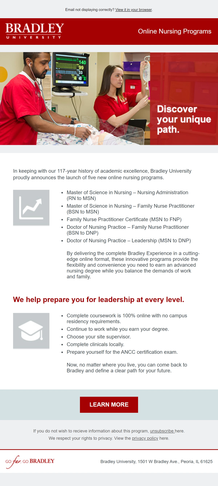

## One starting file for AOP

My custom Pearson emails came first. Later, I built a master HTML template for the art department to use on AOP campaigns. Each email needed its own offer and branding, but the team kept rebuilding familiar headers, content rows, buttons and footers.

I collected those pieces in one commented file. A designer could copy a complete section, replace its content and keep the surrounding layout intact. I handled the HTML/CSS, fluid layouts, brand options and editing notes.

## Shared styles, written for email

The master uses repeated inline CSS and table attributes for its shared values. Email was a different constraint from my web work, where I usually keep style tokens in `:root` variables.

| Rule | Value in the source |
| --- | --- |
| Actions and accent headings | `#2AB5CD` |
| Body and supporting text | `#444444` and `#777777` |
| Footer surfaces | `#e2e7ea` and `#f0f3f4` |
| Font stack | Mr Eaves Modern, Arial, Helvetica, sans-serif |
| Wrapper | 500 px maximum, 290 px minimum |
| Inner content | 90% of the wrapper |

The [style snapshot](/demo/emails/design-system-tokens.json) collects those values. The template's comments also identify which logos and colors to change for AOP, LIFEPAC, Monarch and the other product brands.

## Rows the team could reuse

The file includes headers, heroes, introductions, live-text actions, paired images, three-image rows, mirrored image-and-text sections, banners and footers. I put comments around whole sections and smaller editing points so someone could copy a row with its nested tables and gutters intact.

The split row, for example, uses a 38% image cell, a 4% gutter and a 56% text cell. Its smaller action has a different size from the introductory button. Those choices stay with the module when the content changes.

[Open the original AOP master template](/demo/emails/master-email/index.html). Its gray image slots are placeholders for campaign artwork.

## Earlier custom work at Pearson

At Pearson Online Learning, I built individual campaign emails for university programs. The archive includes desktop and mobile design files alongside the HTML. Bradley's nursing campaign is one example.

*The Bradley campaign, rendered from my HTML. The original desktop and mobile designs are linked below.*

[View the desktop design](/demo/emails/bradley/design-desktop.webp), [view the mobile design](/demo/emails/bradley/design-mobile.png), or [open my Bradley HTML build](/demo/emails/bradley/index.html). The earlier [Kent State](/demo/emails/sample1/index.html) and [UF Online](/demo/emails/sample2/index.html) campaigns are also available.

## Four ways to handle a smaller screen

I also kept examples of fixed, adaptive, fluid and responsive email layouts. This viewer runs those original HTML files. Change the layout approach and preview width to see what the code does.

<iframe class="project-component-demo" src="/demo/emails/layouts/index.html" title="Original email layouts: fixed, adaptive, fluid and responsive" loading="lazy" height="900"></iframe>

[Open the layout comparison](/demo/emails/layouts/index.html).

The fixed example stays 600 px wide on a phone. The adaptive version jumps between fixed widths at breakpoints, so it can still overflow between them. The fluid version uses percentage widths; the responsive version adds media queries for smaller layouts. The differences are visible in the headers, content rows and actions.

## Keeping the handoff usable

For the AOP master, the editing notes cover branding, image folders and sections that can be removed or repeated. Outlook conditional markup and Microsoft-specific button styles sit alongside the regular HTML.

I repaired the archive's old image paths using the bundled assets and retained the original layout rules. The browser previews show the structure and responsive behavior. Delivered rendering in Outlook, Gmail and other email clients needs separate testing.
