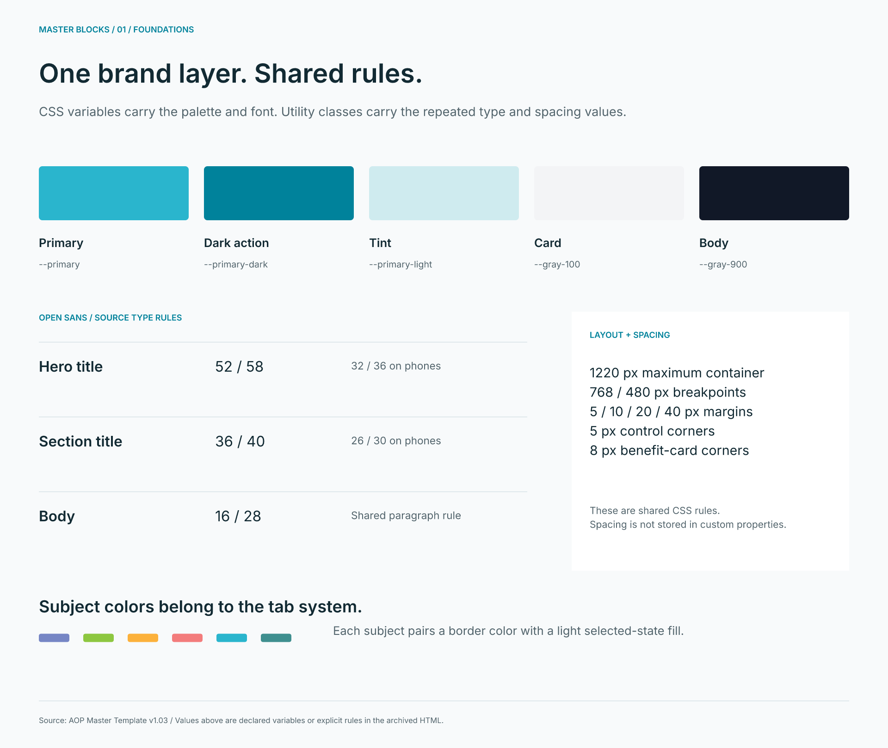
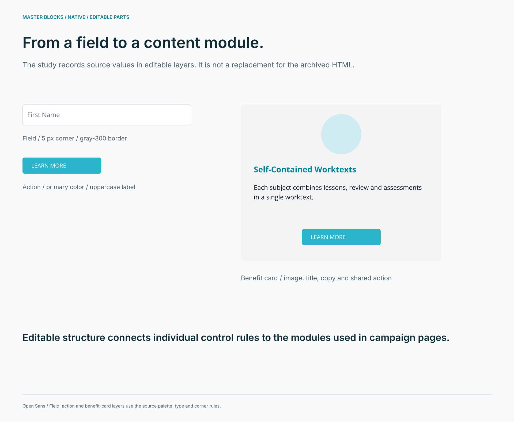
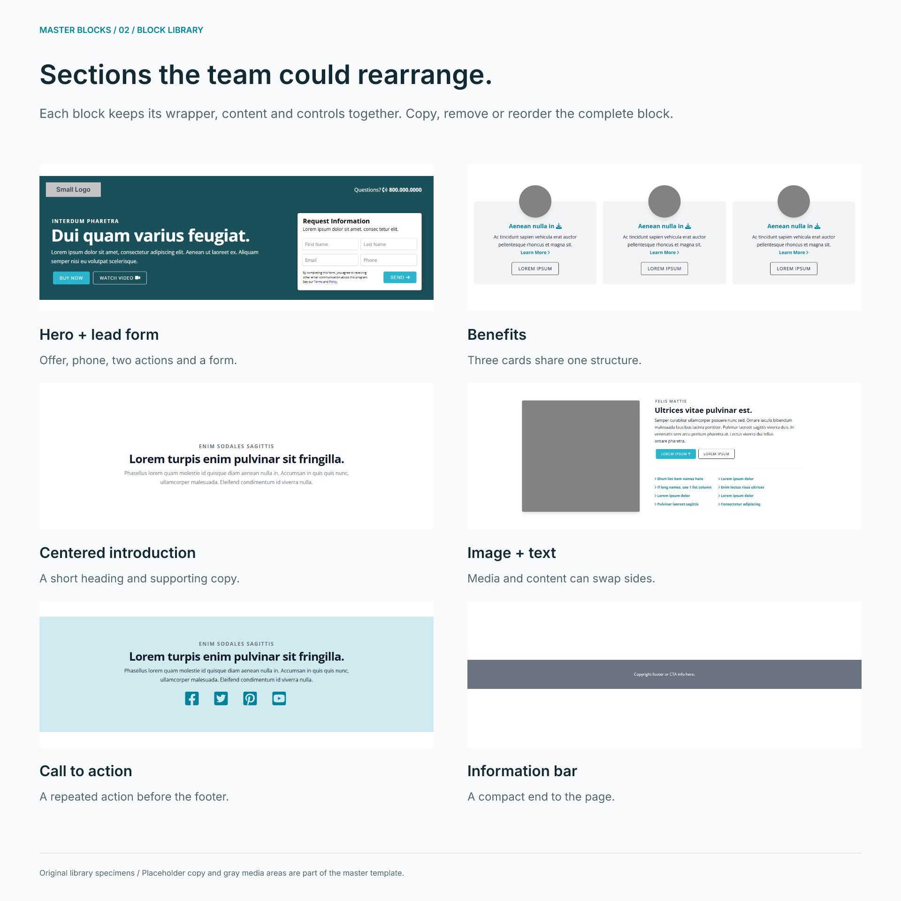
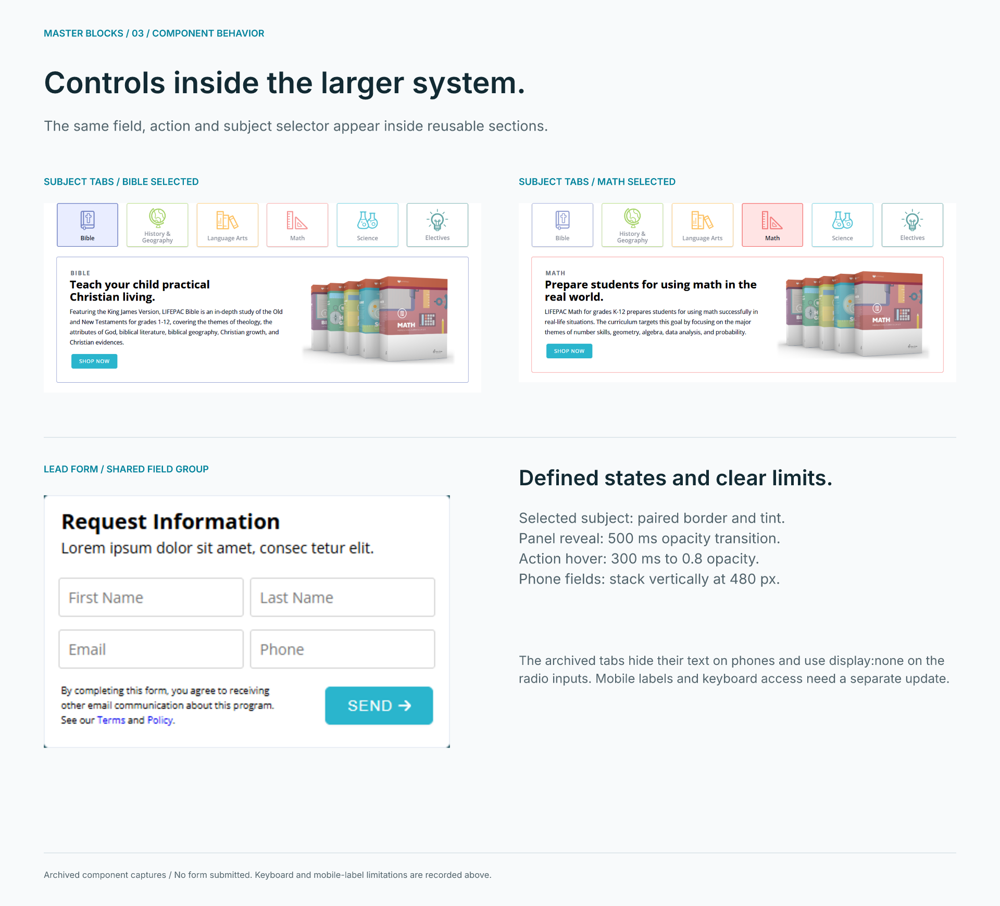
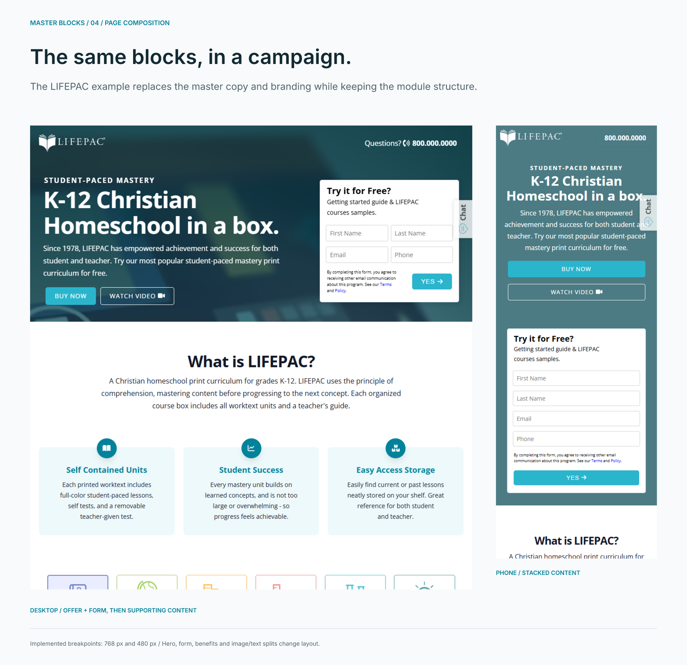
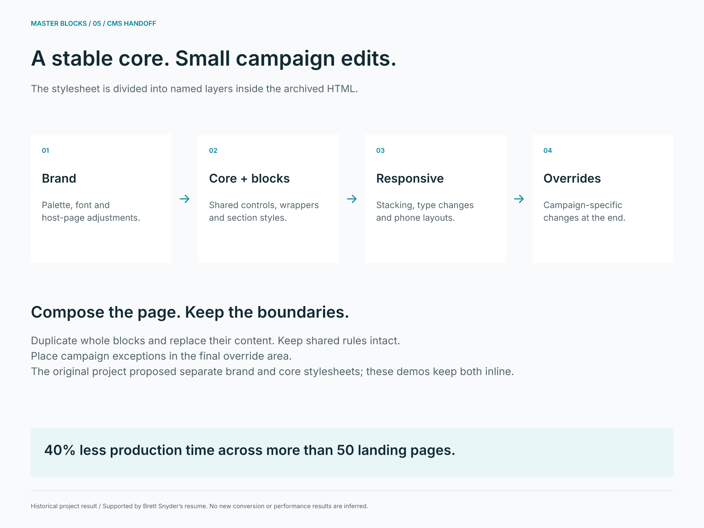

## A library the team could use

Marketing needed landing pages for a busy season that had already started. They supported six product brands across WordPress and a custom .NET CMS. The team knew how to edit HTML in content buckets and widgets, and they needed to keep that control.

I was given a wireframe for the first page. I proposed a master template with reusable blocks so we could handle the campaigns that would follow. I designed and built the HTML, CSS, responsive layouts and interactive pieces, then organized them for the team's day-to-day editing.

These boards document the system in that work, from the declared variables through the campaign example.

## Brand values and shared rules

The brand layer holds CSS variables for the palette and Open Sans. Controls, body copy and section styles refer back to those values. Changing the brand layer carries the new colors and font through the page.

Type sizes and spacing live in shared classes. The main heading runs at 52/58 px on desktop and 32/36 px on phones. Paragraphs use 16/28 px. Margin utilities repeat 5, 10, 20 and 40 px values; most section wrappers share a 1220 px maximum width.

[Inspect the source values](/demo/master-blocks/design-system-tokens.json).

## Small parts, complete sections

Fields, actions, text styles and media slots combine into larger components. A benefit card contains an image, heading, description and action. The hero combines the offer, phone link, button group and lead form.

I kept each section's wrapper, content and controls together. The team could duplicate a benefits block, swap an image-and-text section, or remove a section without rebuilding the rest of the page. Flex layouts handled the rows and stacking.

The master intentionally contains placeholder copy and media areas. The campaign example shows those structures with product branding and content.

## Behavior inside the blocks

The subject selector pairs each category with a border color and a pale selected fill. Radio inputs and CSS selectors switch the content panel, with a 500 ms opacity transition. Buttons use a 300 ms hover fade. The form switches its field rows to a single column on phones.

<video controls playsinline preload="none" poster="/demo/master-blocks/design-system-interactions-poster.webp" width="1280" height="900">
  <source src="/demo/master-blocks/design-system-interactions.mp4" type="video/mp4">
  <a href="/demo/master-blocks/design-system-interactions.mp4">Watch the subject-tab transitions.</a>
</video>

For this archive review, I restored keyboard access to the subject selector and kept its labels visible on phones. Inactive panels stay out of the focus order. The video uses a native dialog, and the form handles its demo action locally without sending information.

## From modules to a campaign

For the LIFEPAC page, the hero introduces the offer and keeps the form close to it. The introduction, benefits, subject content and supporting sections follow. This order reflected the team's earlier testing and audience; I wouldn't treat it as a rule for every campaign.

At 768 px, the hero, benefits and split sections stack. At 480 px, heading sizes, field rows and button layouts adjust again.

## Keeping campaign edits manageable

The stylesheet separates brand and host-page adjustments, core and block styles, responsive rules, and final overrides. That last area gave the team somewhere to put campaign exceptions without rewriting shared styles. The original project proposed separate brand and core files; the archived demos keep these layers inline.

The system reduced landing-page production time by 40% across more than 50 pages. It gave the team a common starting point they could edit in the tools they already used.

[Open the master library](/demo/master-blocks/aop-master-lp-blocks.html), [view the campaign example](/demo/master-blocks/example-aop-lp.html), or [download the system notes](/demo/master-blocks/master-blocks-system-notes.pdf).
