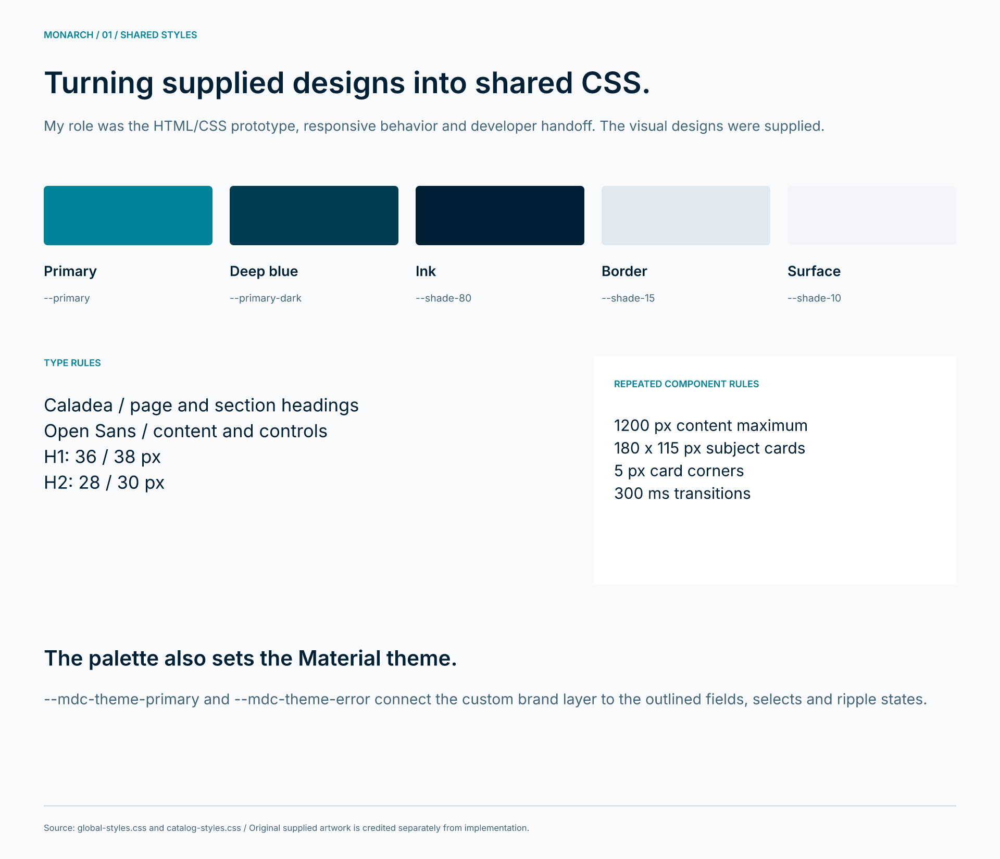
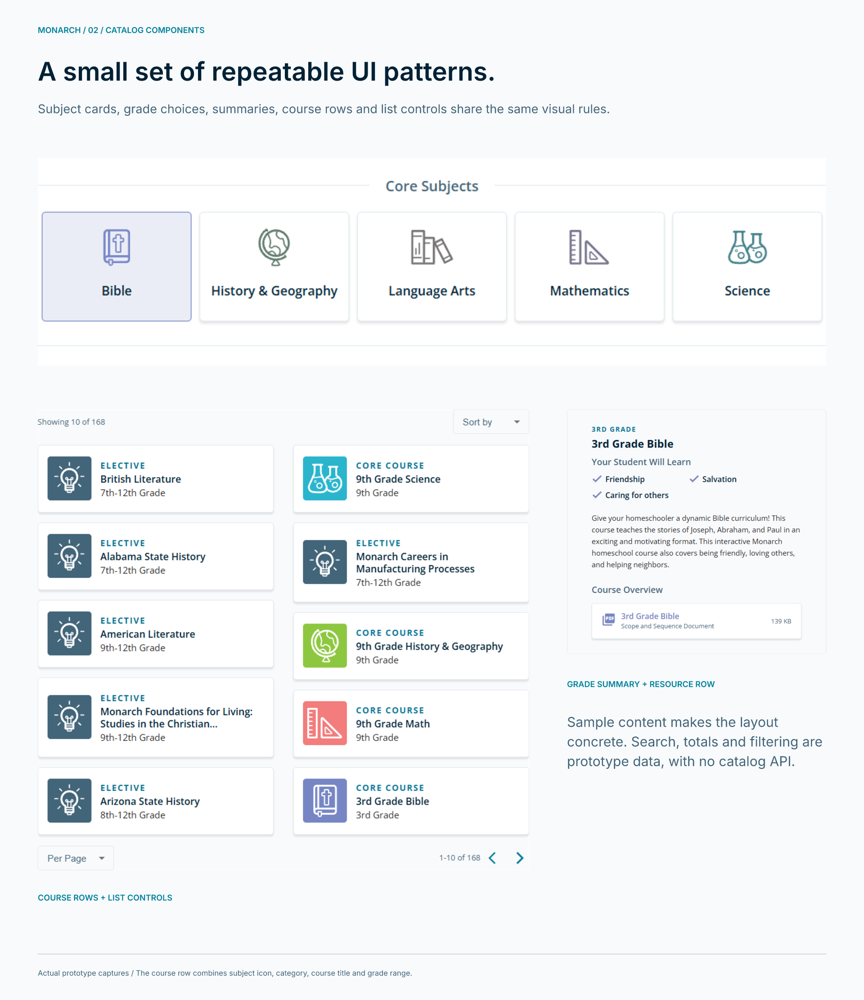
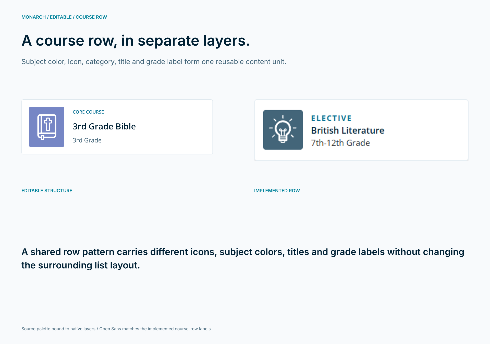
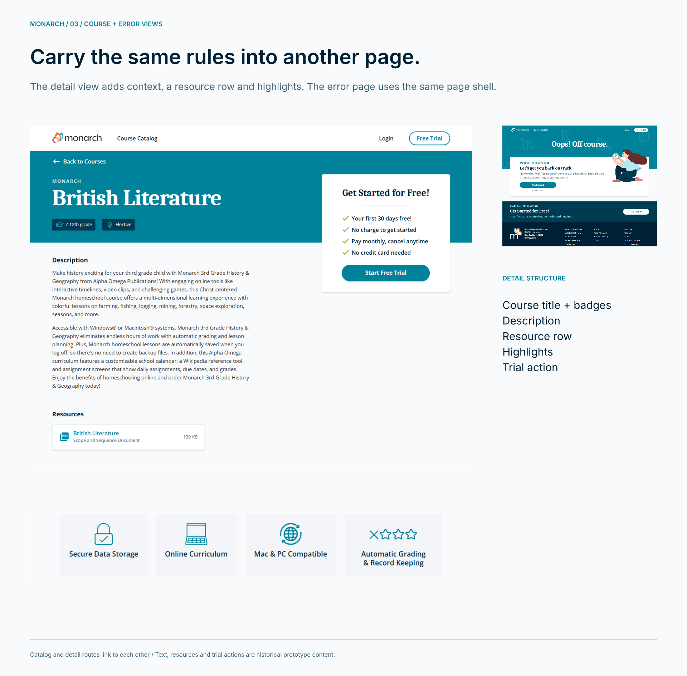
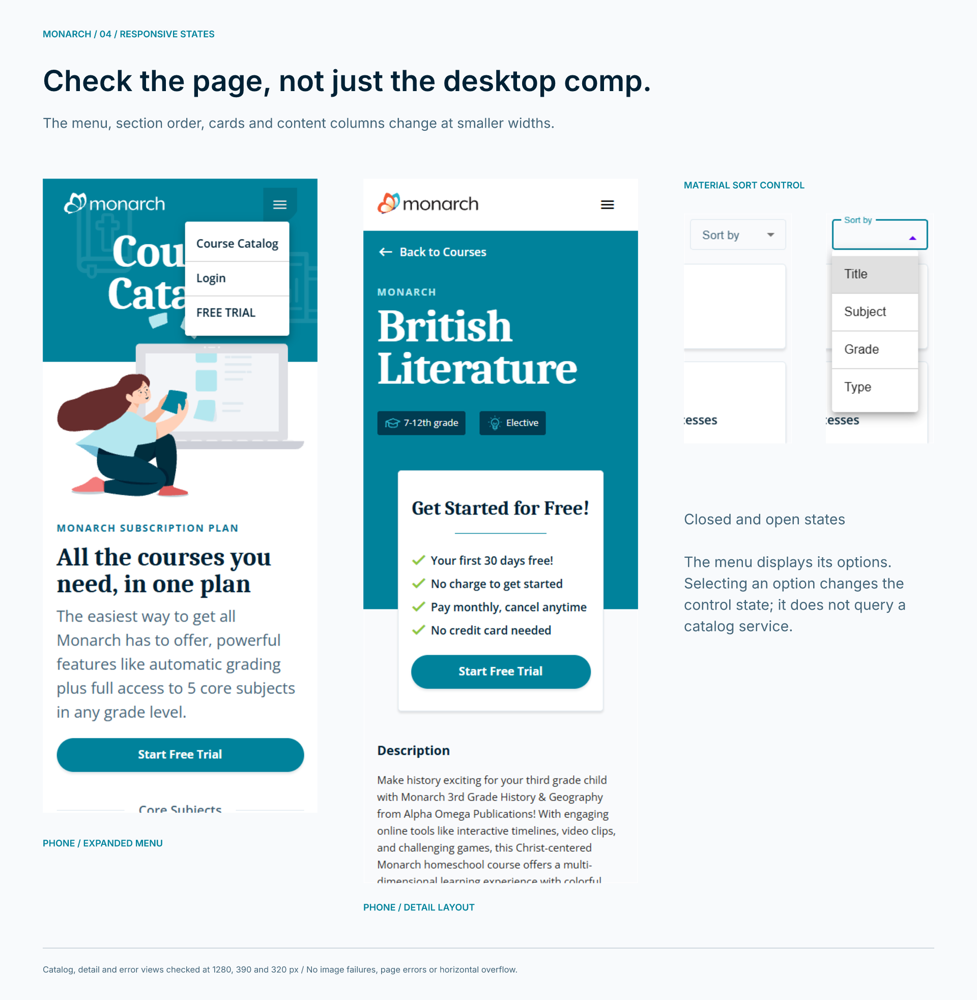
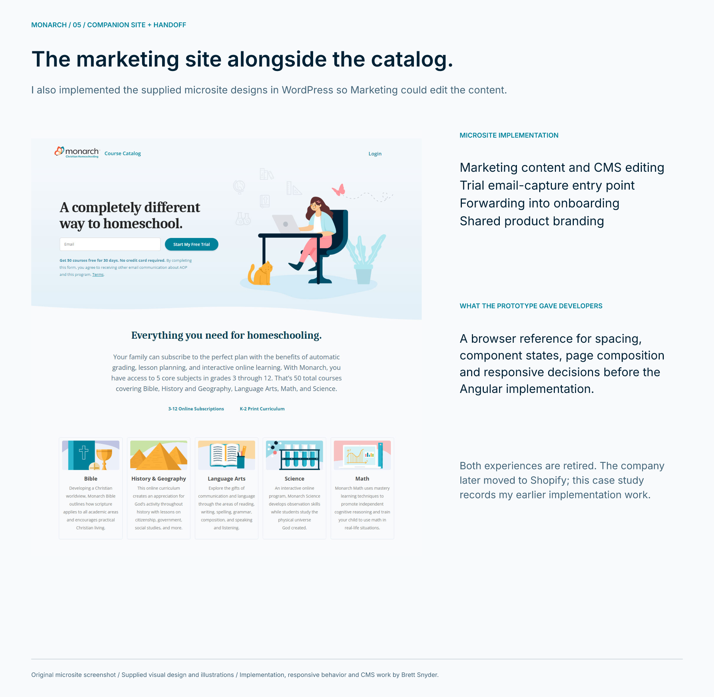

## From supplied designs to a browser prototype

The development team needed to see how the proposed Monarch catalog would work before building it in Angular. I was given the visual designs and built the HTML/CSS prototype: the catalog, course-detail page, responsive layouts and interface states.

The team planned to use Material components, so I used Material Components for the Web for the outlined fields, selects and ripple behavior. The prototype gave us something we could resize, click through and inspect together.

## Shared styles and component rules

I mapped the supplied design into reusable CSS values and classes. The palette defines the main teal, deeper blues, borders, surfaces and subject colors. Material theme properties connect that palette to its controls.

Caladea handles the larger headings; Open Sans handles content and controls. Page headings use 36/38 px, section headings use 28/30 px, and the main content wrappers share a 1200 px maximum. Cards repeat 5 px corners and 300 ms transitions.

[Inspect the shared styles](/demo/monarch-catalog/design-system-tokens.json).

## Building the catalog from repeatable parts

Subject cards introduce the core curriculum. Grade choices sit beside the description, summary and resource row. Further down, course entries share a subject icon, category, title and grade range. Sorting, page-size and pagination controls frame the list.

The row pattern carries different content without changing the list structure. This was the kind of detail developers could inspect directly: how much space the icon takes, where a long title wraps, and how the category and grade labels relate to it.

The catalog uses sample content and totals. The Material controls change their interface state, but search and filtering are not connected to a catalog service.

## The course page and the error state

The detail page reuses the page shell, type and color rules. Its hierarchy moves from course title and badges to the description, resource row and highlights. A trial action stays close to the course information.

I also built the 404 view so the error state belonged to the same experience. The catalog and detail routes link to each other, giving developers a short page flow to review.

## Checking the responsive behavior

The prototype let me work through the smaller layouts instead of leaving those decisions to a desktop comp. Navigation collapses, content columns stack, and the catalog cards and course information adjust to the available width.

<video controls playsinline preload="none" poster="/demo/monarch-catalog/prototype-interactions-poster.webp" width="1280" height="900">
  <source src="/demo/monarch-catalog/prototype-interactions.mp4" type="video/mp4">
  <a href="/demo/monarch-catalog/prototype-interactions.mp4">Watch the dropdown, course-row hover and page navigation.</a>
</video>

The preserved catalog, detail and error views have been checked at desktop, 390 px and 320 px widths. For this archive, I also repaired asset references and field labels. The content remains a historical prototype with sample copy and actions.

## The companion microsite

I built the marketing microsite from supplied designs as well. Marketing needed direct access to its content, so I implemented it in WordPress. Later, I changed the trial calls to action into email-capture forms that forwarded visitors into the onboarding site.

The microsite and catalog were retired when the company moved to Shopify. This project records my earlier frontend and CMS work, including the shared styles and responsive decisions the development team could carry into the application.

[Open the catalog](/demo/monarch-catalog/course-catalog.html), [view the course page](/demo/monarch-catalog/course-detail.html), [view the error page](/demo/monarch-catalog/error-404.html), or [download the prototype notes](/demo/monarch-catalog/monarch-prototype-notes.pdf).
