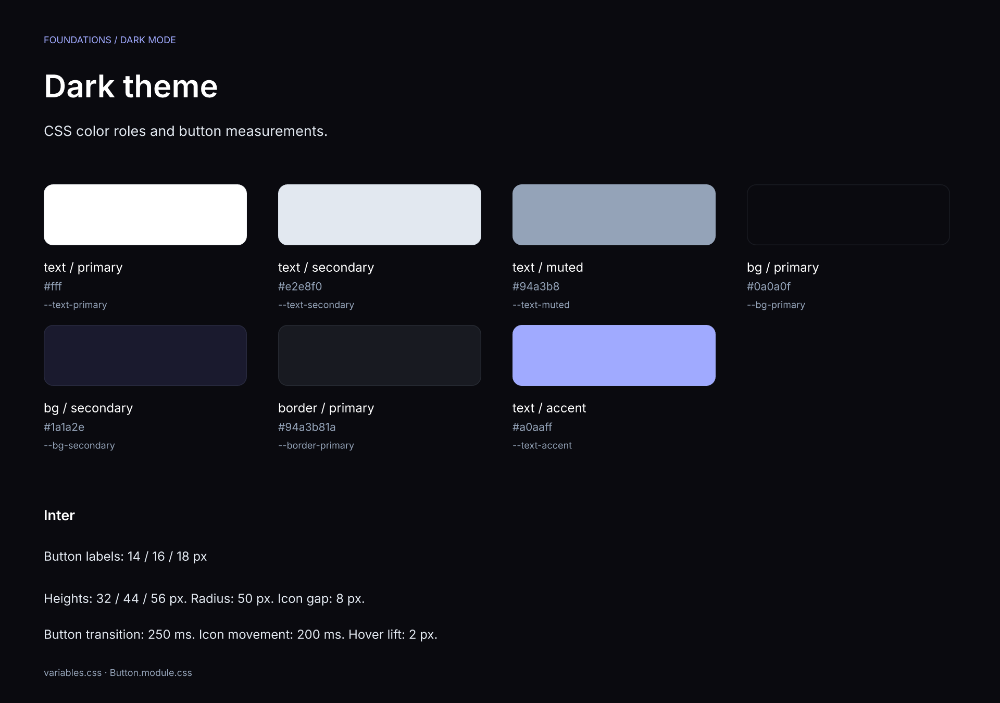
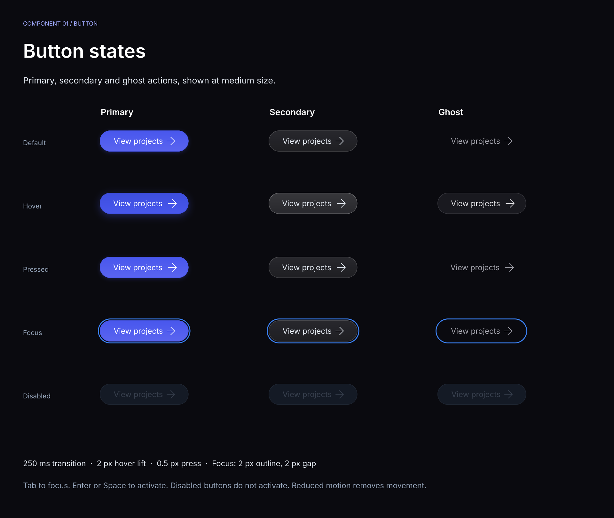
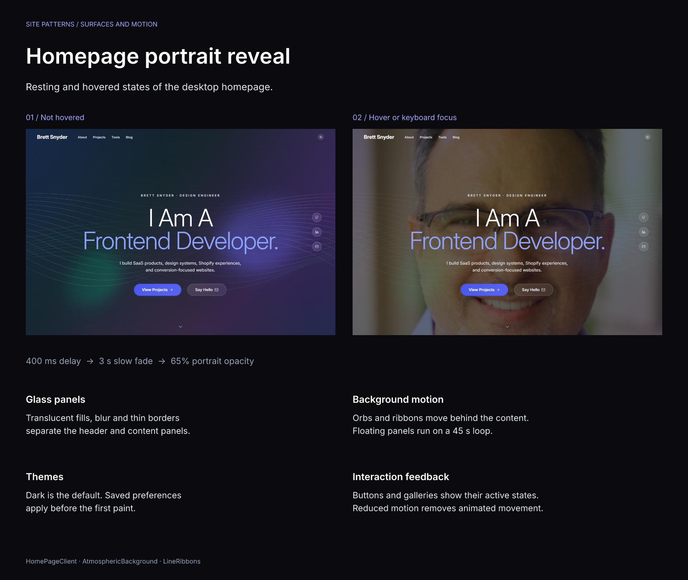
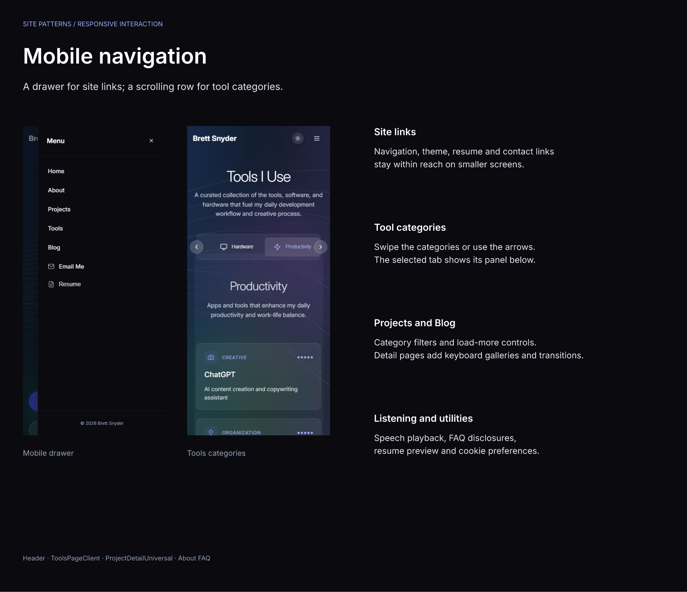
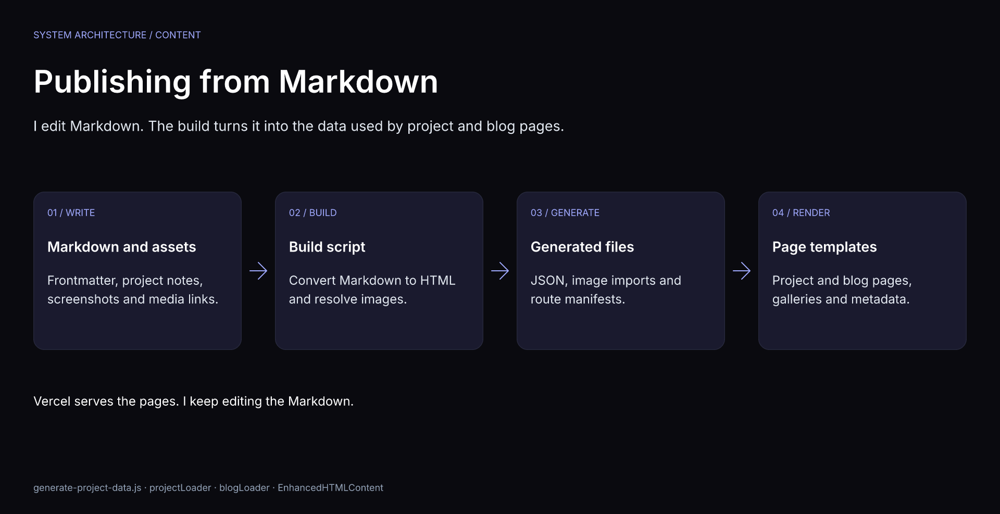

## The Brief

I built this site to bring my projects, writing and resume together. I worked directly in the browser, using dark backgrounds, glass panels and slow motion. The light theme keeps the same layout.

## Foundations

CSS variables hold the colors for text, surfaces, borders and accents. Each theme supplies its own values. I use Inter for the interface and JetBrains Mono for code.

[Download the tokens as JSON](/demo/portfolio/portfolio-tokens.json) or [view the CSS](/demo/portfolio/portfolio-tokens.css).

## Buttons

The React button has primary, secondary and ghost variants, three sizes and optional icons. The board shows its default, hover, pressed, focus and disabled states.

[Open the vector state board](/demo/portfolio/button-states.svg).

### Try the Component

Change the theme or size, toggle Disabled, or press Tab to inspect keyboard focus.

<iframe class="project-component-demo" src="/demo/portfolio/components" title="Portfolio button component playground" loading="lazy" height="700"></iframe>

[Open the playground on its own](/demo/portfolio/components).

### Motion and Feedback

Hover lifts the button by two pixels. Pressing brings it back toward rest. The recording shows those changes and keyboard focus; reduced motion removes movement and transitions.

<video controls playsinline preload="none" poster="/demo/portfolio/button-motion-poster.webp" width="1200" height="700">
  <source src="/demo/portfolio/button-motion.mp4" type="video/mp4">
  <a href="/demo/portfolio/button-motion.mp4">Watch the button interaction recording.</a>
</video>

## Patterns Across the Site

### Glass and Ambient Motion

The header and panels use translucent fills and blur. Orbs and ribbons move behind the content, while the floating panel drifts on a slow loop.

The desktop portrait slowly appears on hover or focus. Mobile uses a square crop.

### Navigation and Mobile Tabs

The header links become a mobile drawer. [Tools](/tools) keeps its categories in a horizontal slider with touch scrolling and arrow controls.

### Supporting Interactions

- [Projects](/projects) and [Blog](/blog) have category filters and load-more pagination.
- Galleries combine images and YouTube videos, with thumbnails and keyboard navigation.
- Supported browsers animate card images into detail pages and give Previous/Next links directional transitions.
- Listen uses browser speech playback with a voice picker. [About](/about) has native FAQ disclosures.
- The resume opens in a PDF preview. Cookie preferences stay available from the footer.

## Content and Implementation

I write projects and blog posts in Markdown. At build time, a script converts the text to HTML in JSON, imports images and updates the manifests used by the page templates.

[Download the design system PDF](/demo/portfolio/portfolio-system-overview.pdf).
