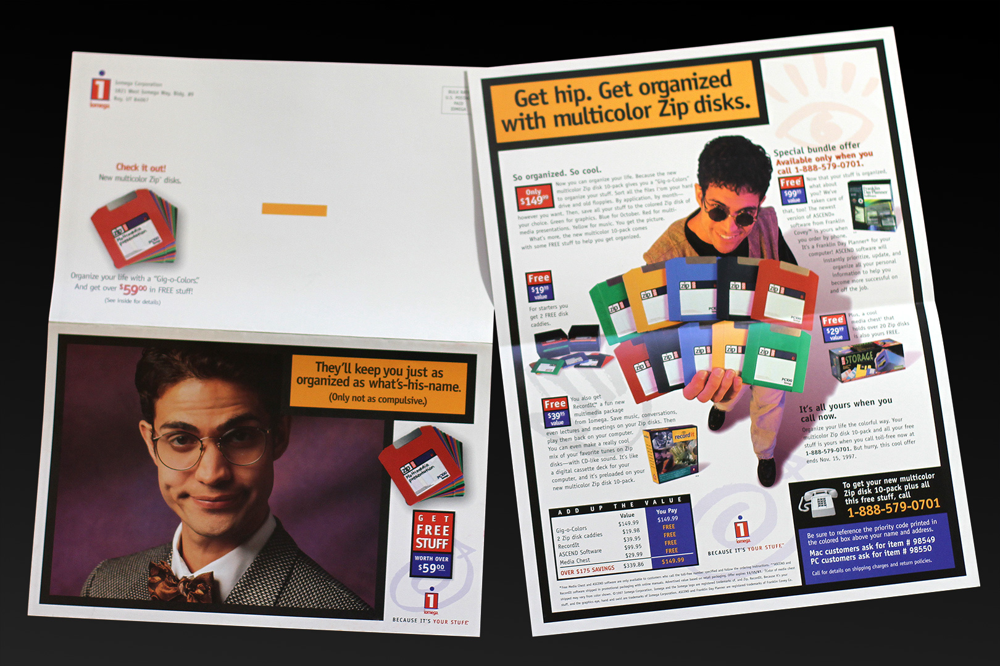
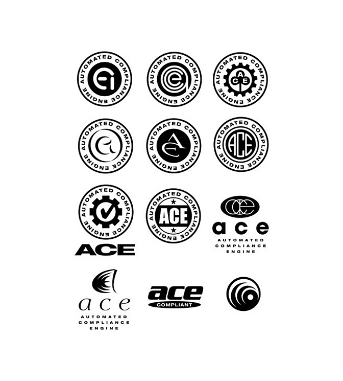

I still remember the daily trips to the typesetter to collect the type for my print projects. I'd hot-wax it in place for printer handoff. Later, I borrowed my boss's Mac Plus and used our laser printer to bring that step in-house.

Here are a few of my favorite print projects.

## Catalogs

For this Franklin Quest catalog mockup, I wanted more space around the images and copy. I prefer a layout that gives the reader room to take things in.

## Mailers

Don't you love all the direct mail you get every week? Sorry, some of that was me.

This Iomega mailer introduced multicolor Zip disks with a nerd-to-hipster concept and plenty of extras in the offer. The challenge was fitting it all into a piece someone would want to read.

## Logos

For ACE (Automated Compliance Engine), I explored circular seals, monograms and wordmarks in a single color.

## Ads

This full-page Monarch ad pairs a short introduction to the curriculum with one trial call to action.

## Brochures

For Reebok's elliptical brochure, I used larger product images, motion lines and bold type, with feature callouts around the edges.

I've also designed newspapers, newsletters, billboards, stationery and packaging, and worked with printers and prepress teams through press checks in Hong Kong and other cities.
