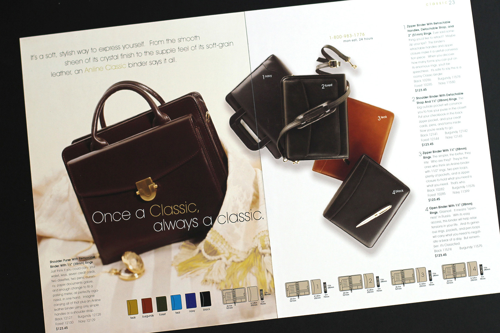
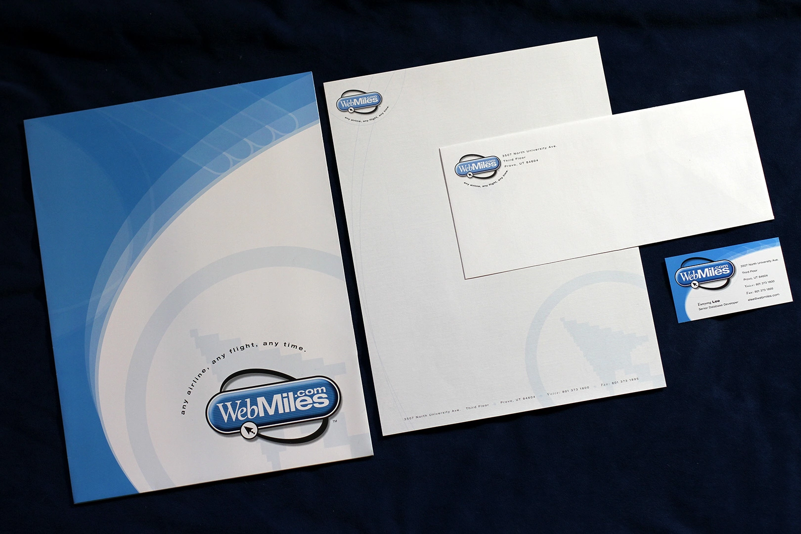
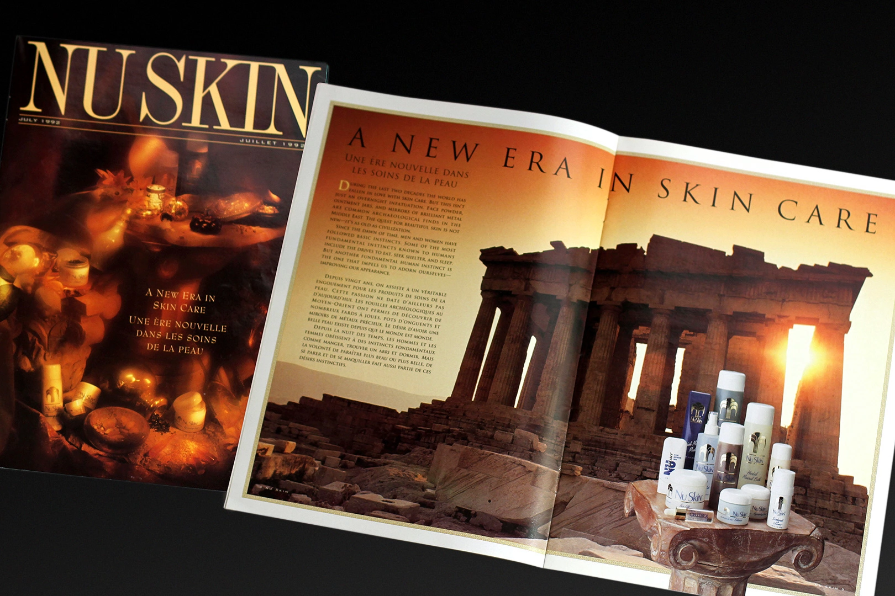
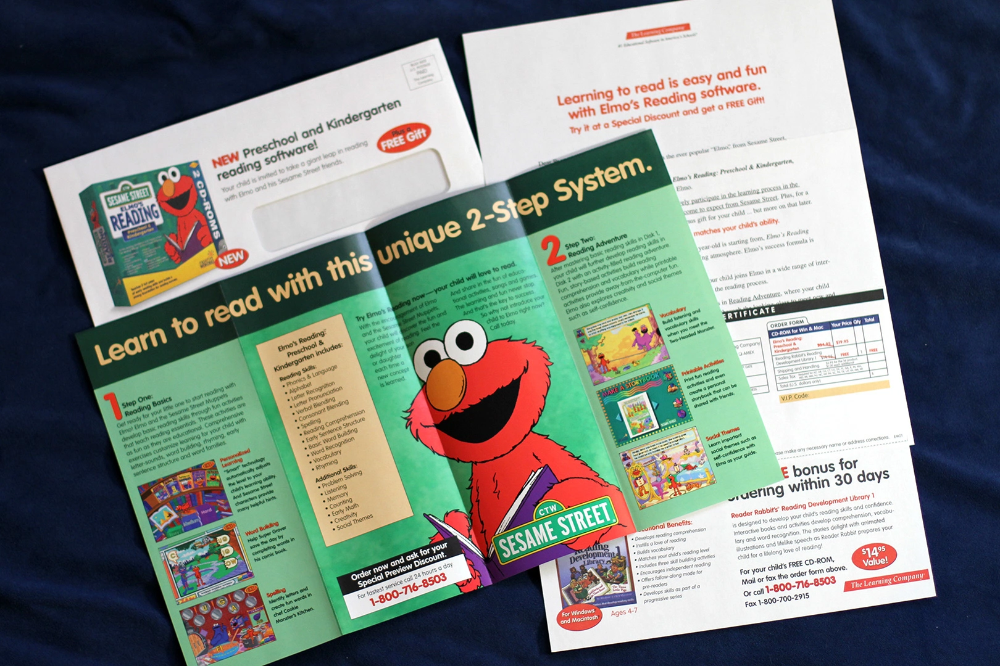
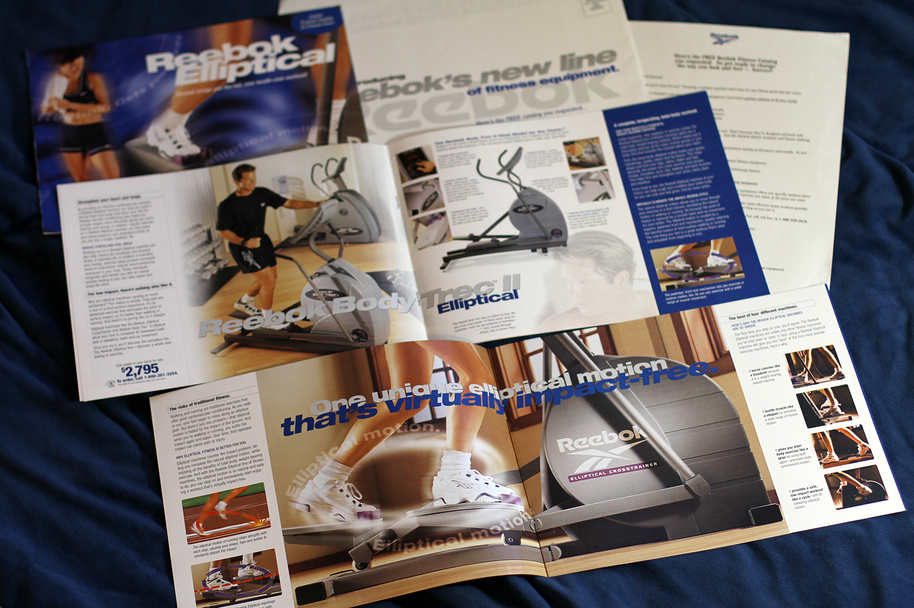
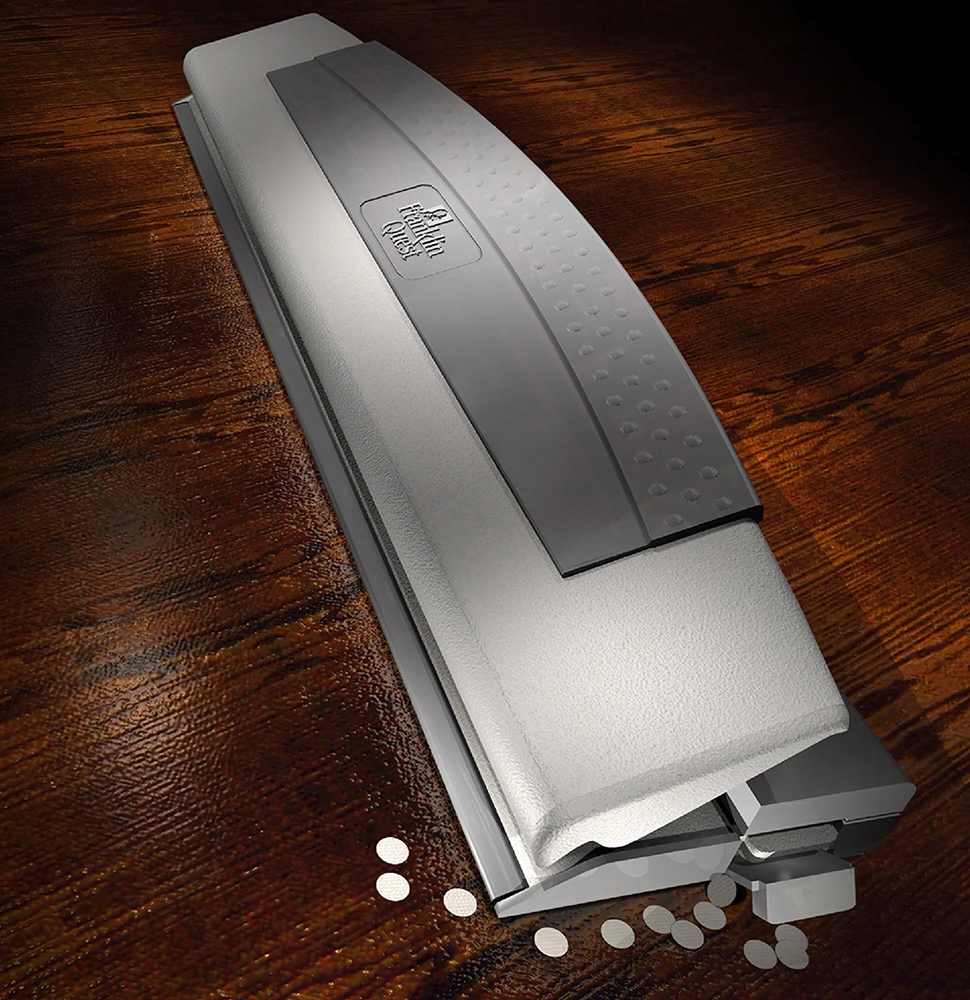

I still remember the daily trips to the typesetter to collect the type for my print projects. I'd hot-wax it in place for printer handoff. Later, I borrowed my boss's Mac Plus and used our laser printer to bring that step in-house.

Here are a few of my favorite print projects.

## Catalogs

For this Franklin Quest catalog mockup, I wanted more space around the images and copy. I prefer a layout that gives the reader room to take things in.

## Mailers

Don't you love all the direct mail you get every week? Sorry, some of that was me.

This Iomega mailer introduced multicolor Zip disks with a nerd-to-hipster concept and plenty of extras in the offer. The challenge was fitting it all into a piece someone would want to read.

## Identity

The WebMiles work carried one identity across a folder, stationery and business cards. Seeing the pieces together mattered as much as judging the mark on its own.

## Editorial

Magazine covers and editorial spreads were part of my NuSkin work. Product photography, longer copy and display type had to share the page.

## Campaign collateral

For these Brøderbund mailers, I worked the offer, product details and reply panel around the campaign's supplied character and product artwork.

## Ads

This full-page Monarch ad pairs a short introduction to the curriculum with one trial call to action.

## Brochures

For Reebok's elliptical brochure, I used larger product images, motion lines and bold type, with feature callouts around the edges.

## Product illustration

One from my product illustration work: a hole punch, down to the paper chads.

I've also designed newspapers, newsletters, billboards, stationery and packaging, and worked with printers and prepress teams through press checks in Hong Kong and other cities.
