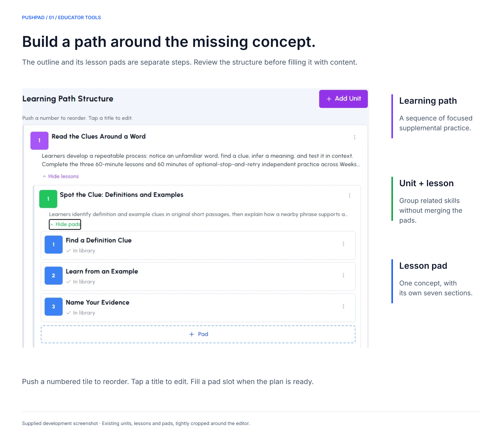
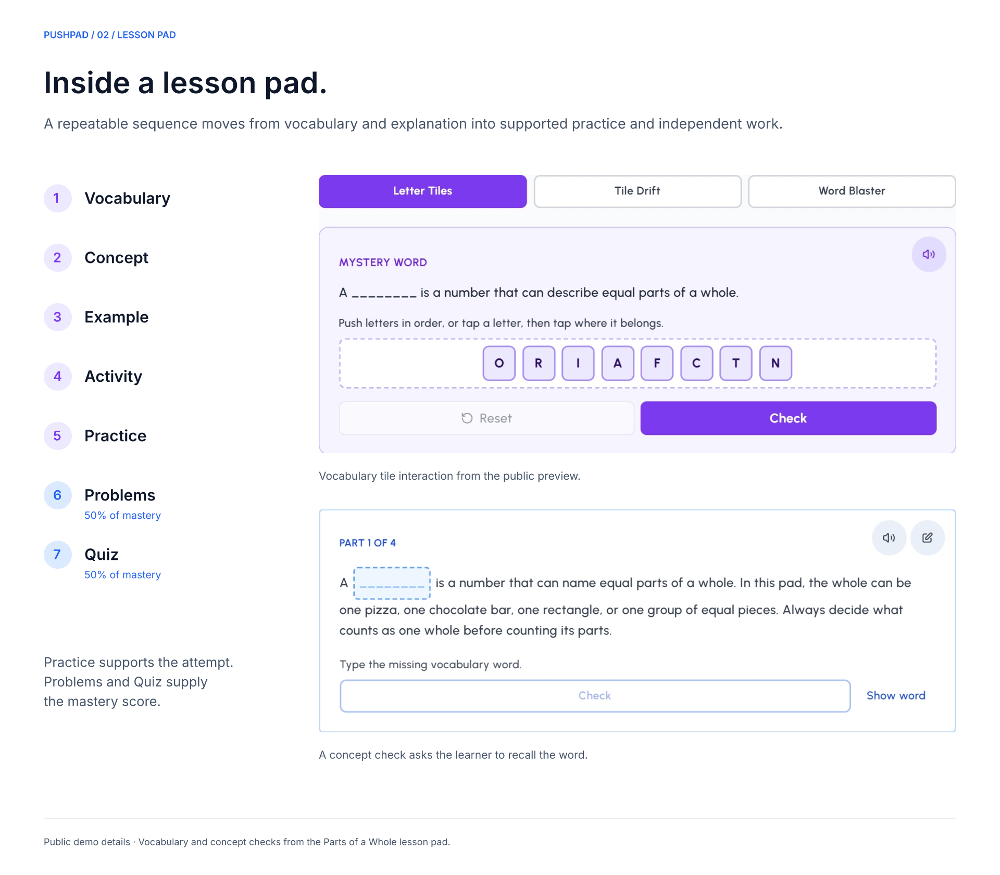
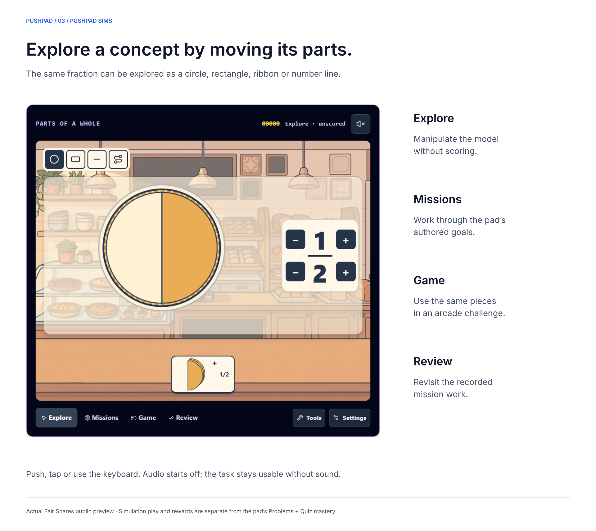
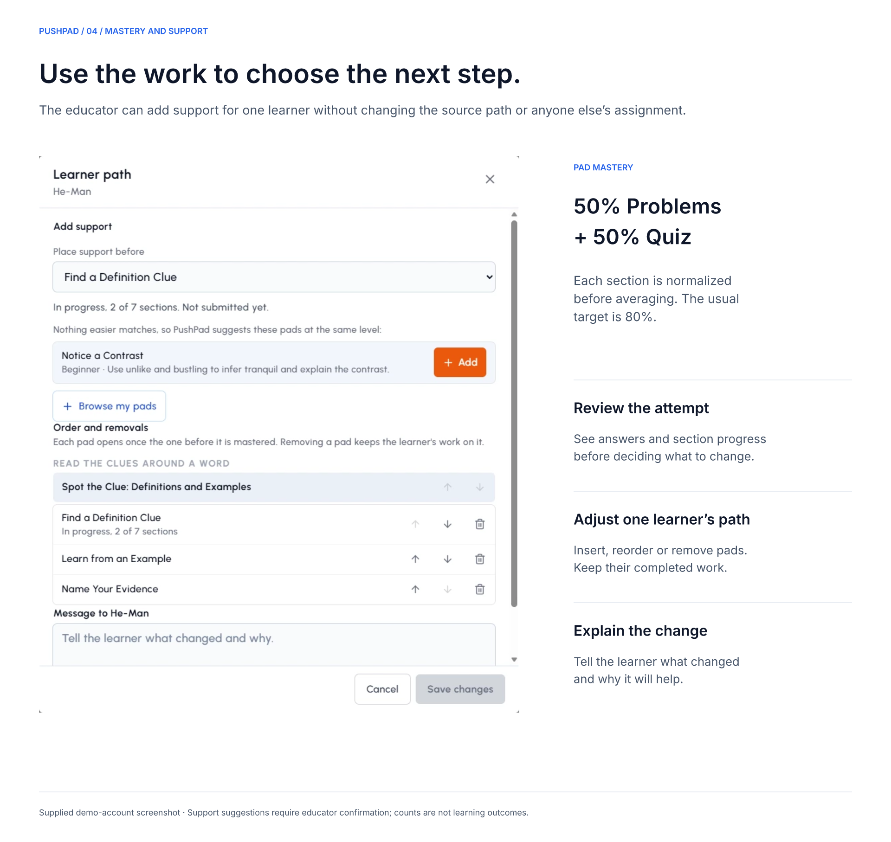
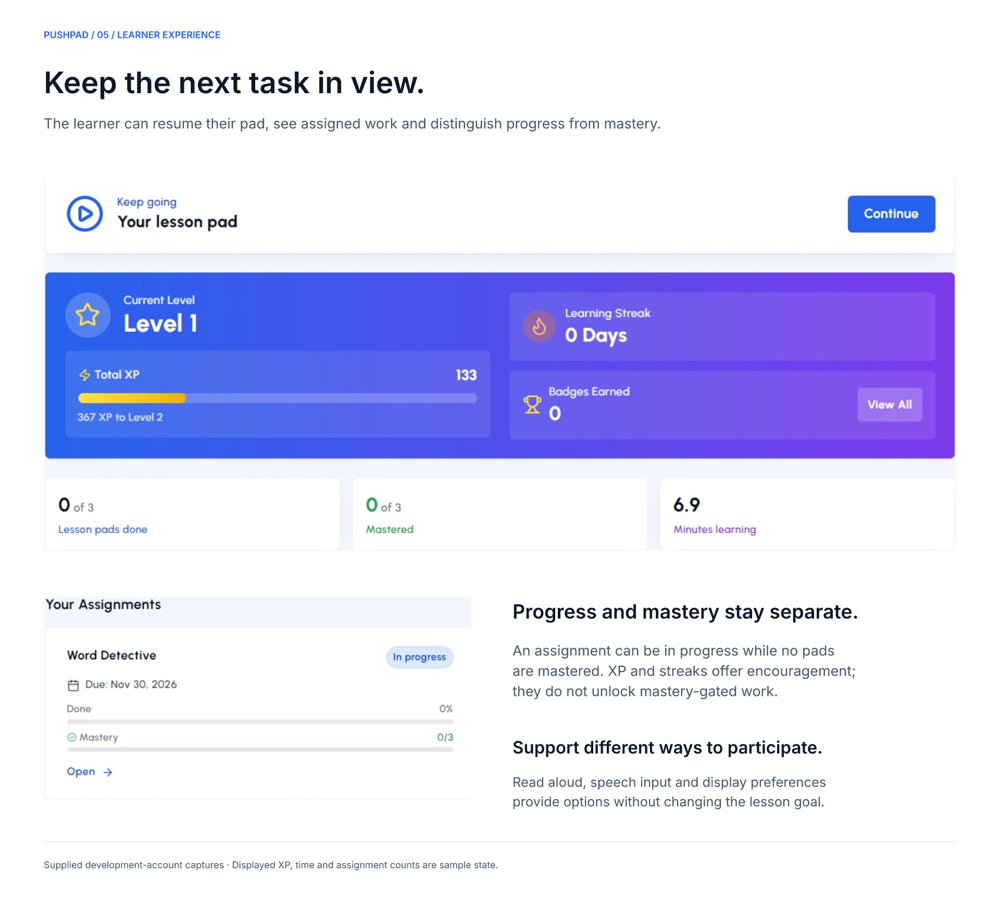
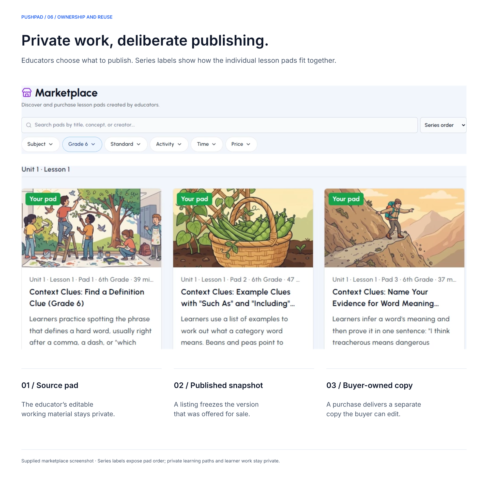

## The Brief

I'm building PushPad for educators who need to give a learner focused practice on something they haven't quite understood. It supplements the instruction they already use. An educator can create a lesson pad for one concept, assign it and use the learner's work to decide what comes next.

I own the product design and implementation, including the educator tools, learner experience, content generation, grading, assignments and marketplace.

## Start With the Concept

A learning path organizes pads into lessons and units. The outline comes first; generating the individual pads is a separate step. That gives the educator a chance to review the sequence, change a title or move a skill before building its content.

Numbered tiles make the hierarchy visible and provide the push-to-reorder control. A pad slot can be filled when it's needed. Educators can assign a whole path, a smaller part of it or a standalone pad.

## Give Each Pad a Consistent Shape

Every lesson pad covers one concept through seven sections: Vocabulary, Concept, Example, Activity, Practice, Problems and Quiz. The learner knows where they are and what comes next, even when the subject or activity changes.

The sections ask for work along the way. A learner might assemble a vocabulary word, recall it inside an explanation, explore a model and then solve a problem independently. Practice gives them room to try before the scored work.

## Make the Concept Something They Can Move

PushPad's interactions use the pad's own words, numbers and questions. Learners push letter tiles into order, move pieces into a model and work through exercises that fit the skill being taught. Dragging has tap and keyboard alternatives.

The Fair Shares simulation lets a learner explore a fraction as a circle, rectangle, ribbon or number line. Explore, Missions, Game and Review use the same concept model for different tasks. The illustrated scene, controls and feedback belong to PushPad's shared game kit.

Arcade play adds another reason to practice. Its points stay separate from the Problems and Quiz score used for pad mastery.

This recording uses the public lesson preview. It shows a fraction piece being pushed into place, then switches between models and modes.

<video controls playsinline preload="none" poster="/demo/pushpad/pushpad-interactions-poster.webp" width="1280" height="900">
  <source src="/demo/pushpad/pushpad-interactions.mp4" type="video/mp4">
  <a href="/demo/pushpad/pushpad-interactions.mp4">Watch the PushPad simulation recording.</a>
</video>

## Use Mastery to Guide the Next Step

Problems and Quiz each contribute half of the final mastery score, after their point totals are normalized to percentages. Practice doesn't count toward it. The usual target is 80 percent. When an assignment requires mastery, the next pad stays locked until the learner meets its target.

Grading happens on the server from submitted answers. The learner's browser doesn't choose its own score or decide that the next pad is unlocked. Attempts are recorded so the educator can review the work behind the number.

If more support is needed, the educator can add a related pad, change the order or adjust the deadline for that learner. The support panel also says when it can't find an easier match. Suggestions require confirmation, and a message explains the change to the learner.

## Make Returning to Work Easy

The learner dashboard puts Continue near the top and keeps assignments within reach. Completion and mastery have separate indicators. XP, streaks and awards recognize participation without becoming a shortcut through mastery-gated work.

Read aloud, speech input and display preferences offer different ways to participate. The interface uses Urbanist, shared Tailwind scales and reusable section components. The illustrated activities have their own coordinated controls, while audio starts off and remains optional.

## Reuse Content Without Exposing Private Work

An assignment gets its own learner-scoped copy. Editing the source later doesn't overwrite work already issued, and an adjustment for one learner doesn't change everyone else's path.

Educator material stays private unless an individual pad is explicitly published to the marketplace. A listing freezes that version; a purchase delivers a buyer-owned copy. Series labels show where pads belong in a sequence. The private learning path itself isn't sold or opened to the buyer.

Stripe Connect handles the seller onboarding and payment integration. Learners receive content through their educator's assignments.

## Keep the Experience Consistent as Content Changes

Structured pad data feeds the editor, preview and learner sections. Activity registries connect that data to the right interaction. Generation, validation and rendering have to agree on the same contract, so editing an activity preserves the rules that make it playable.

PushPad remains in active development, with billing and real-device checks still on the launch list. The screenshots show development accounts, and the recording uses the public preview. Displayed scores and counts aren't evidence of learning outcomes.

[Visit PushPad](https://pushpad.com) and choose “Try a Lesson Pad,” [read how PushPad works](https://pushpad.com/how-pushpad-works), or [download the platform notes PDF](/demo/pushpad/pushpad-platform-notes.pdf).
