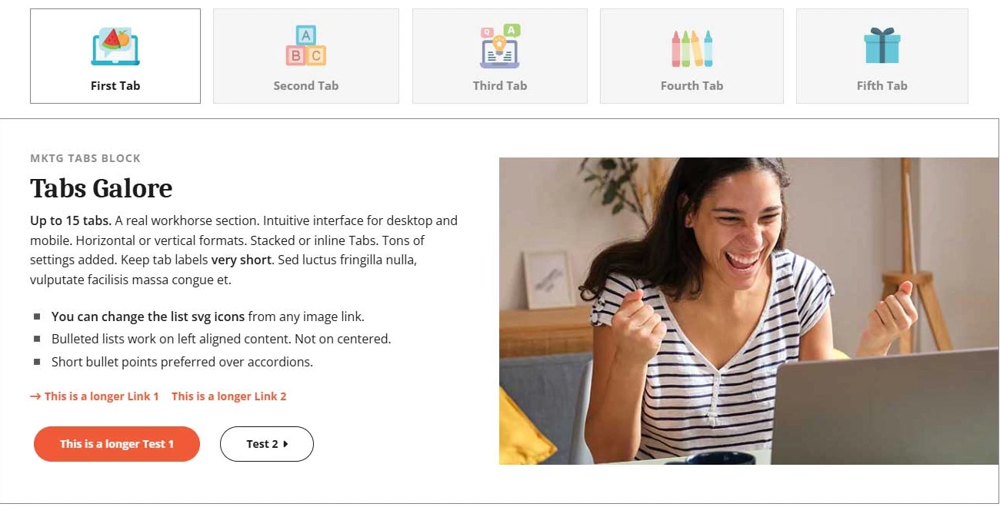
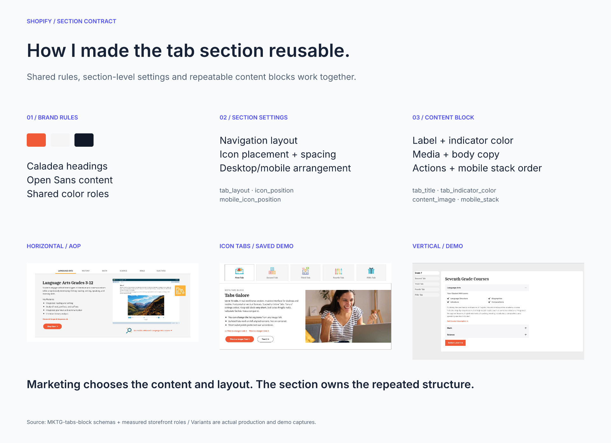
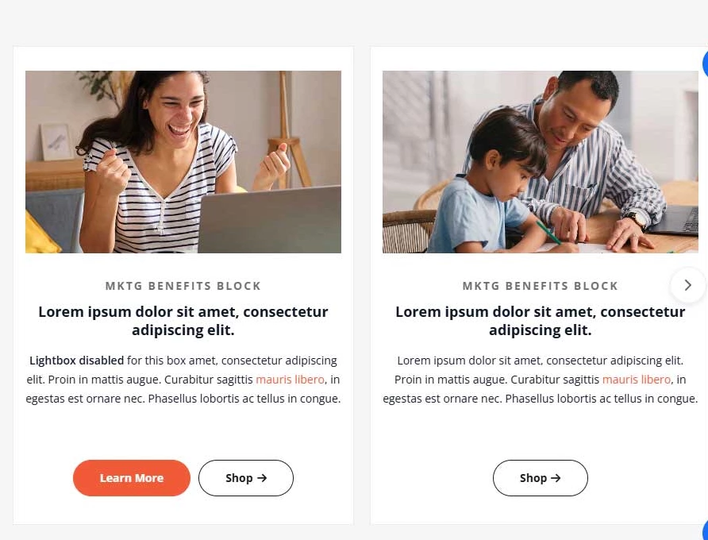
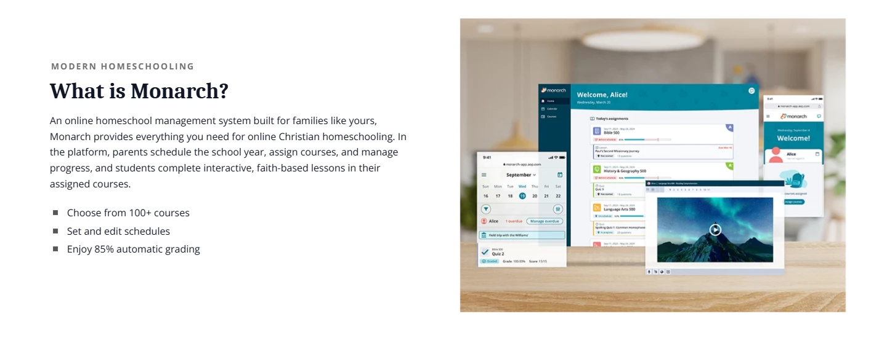
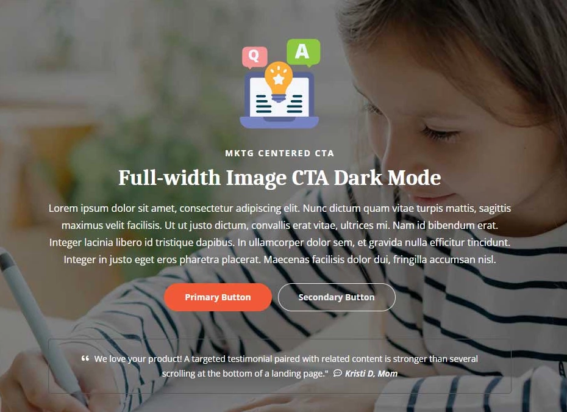
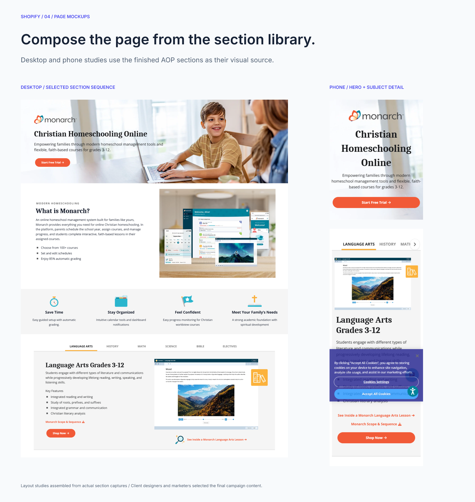
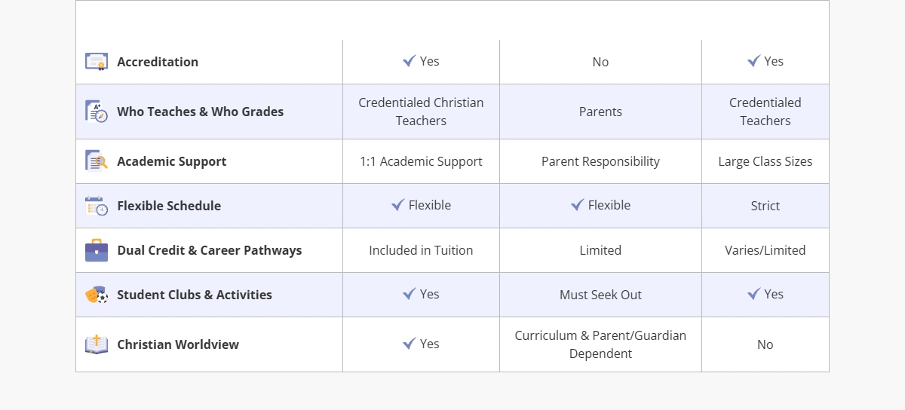

## A section library Marketing could build with

I planned and led Shopify Plus migrations for [AOP](https://aop.com) and [Ignite Christian Academy](https://www.ignitechristianacademy.com). Marketing needed to build campaigns without waiting for each page to be coded.

I built the Liquid sections and their Shopify editor controls: reusable layouts with editable content, media, spacing, actions and mobile behavior. The library replaced marketing functionality that would otherwise have depended on paid apps.

<a href="/demo/shopify-custom-sections.jpg" data-section-gallery>Explore all custom sections</a>

The saved gallery includes placeholder copy and layout variants; the production examples show how the sections were used.

## Tabs that handle more than one layout

The tab section supports text or icon navigation, horizontal or vertical layouts, media panels and accordion content. Editors choose the arrangement and populate each tab without changing the section code.

On AOP, that section becomes a subject browser. Each selection reveals curriculum information and an action for that subject.

<video controls playsinline preload="none" poster="/demo/shopify/subject-tabs-poster.webp" width="1280" height="720">
  <source src="/demo/shopify/subject-tabs.mp4" type="video/mp4">
  <a href="/demo/shopify/subject-tabs.mp4">Watch the AOP subject tabs change panels.</a>
</video>

## Tokens, components and page layouts

The design-system gallery follows the shared tokens, an editable benefit card, section variants, page layouts and a finished storefront. Orange action colors, Caladea headings, Open Sans content and repeated spacing rules carry through the components.

The section schema exposes layout controls; repeatable tab blocks hold the labels, imagery, copy and actions. Liquid renders those choices, with CSS scoped to the section instance.

The [style and schema snapshot](/demo/shopify/design-system-tokens.json) includes examples of the actual settings.

### Try the component

This browser prototype demonstrates the tab structure, layout choices and keyboard behavior. The production section runs in Shopify Liquid.

<iframe class="project-component-demo" src="/demo/shopify/tabs/index.html" title="Interactive Shopify tab-section prototype" width="1200" height="800" loading="lazy"></iframe>

## More sections from the library

### Benefits and content grids

Repeated blocks combine images or icons, headings, copy and actions. Editors control the card treatment, spacing and layout, including a side-scroll option.

### Media and product explanations

Image-and-text sections handle product details, screenshots and video. Alignment and mobile spacing are configurable. This example is from AOP's finished Monarch page.

### Campaign calls to action

The library supports contained and full-width campaigns, image or video backgrounds, and light and dark treatments.

## Built into two Shopify Plus storefronts

The page mockups show how the finished AOP sections fit together at desktop and phone sizes, from the hero and product explanation to benefits and subject detail.

Ignite's landing page brings campaign messaging and a lead form into the same hero. Farther down, the comparison section helps families understand the school options.

AOP used Kalles; Ignite used Horizon. I also built jump navigation, custom dropdown navigation and a footer, plus dynamic product-detail and collection templates for Ignite. Client designers and marketers chose the final artwork, copy, section order and brand color use.

I kept the custom work additive, handled production fixes and support, and worked with GTM, GA4, Shopify Analytics, Shoplift and Crazy Egg for measurement.

[View AOP's Monarch page](https://aop.com/pages/monarch), [visit Ignite's school overview](https://www.ignitechristianacademy.com/pages/online-school-overview), or [open the technical design-system study](/demo/shopify/shopify-design-system.pdf).
