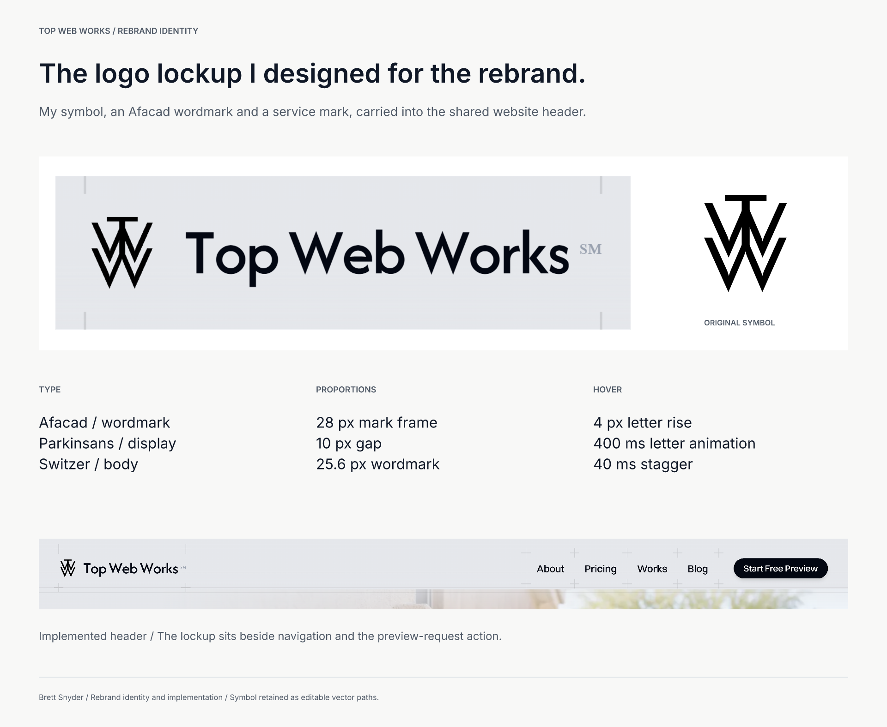
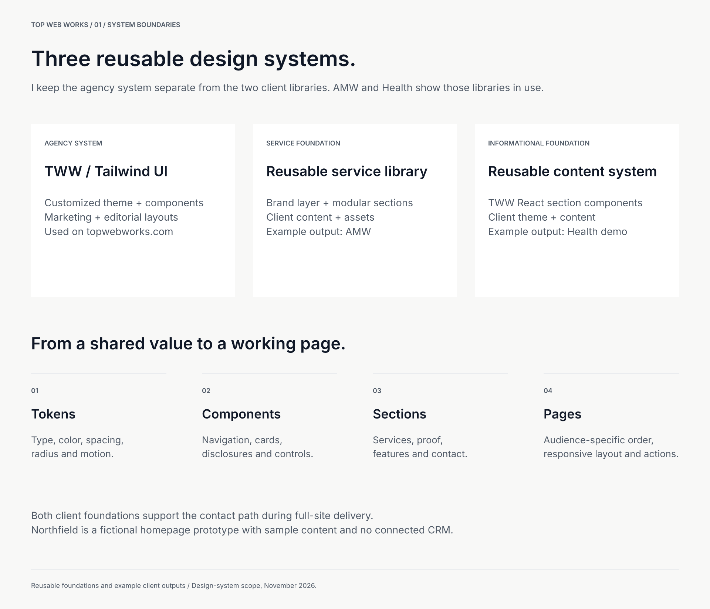
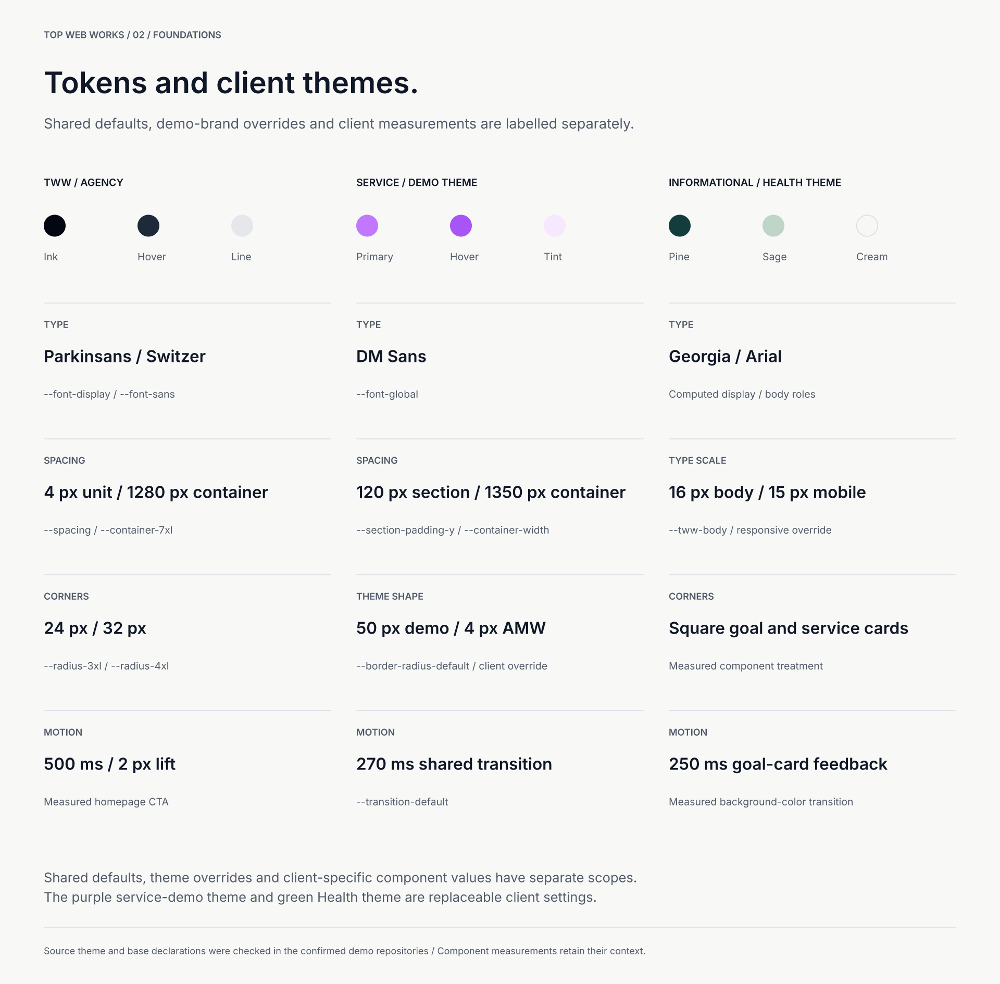
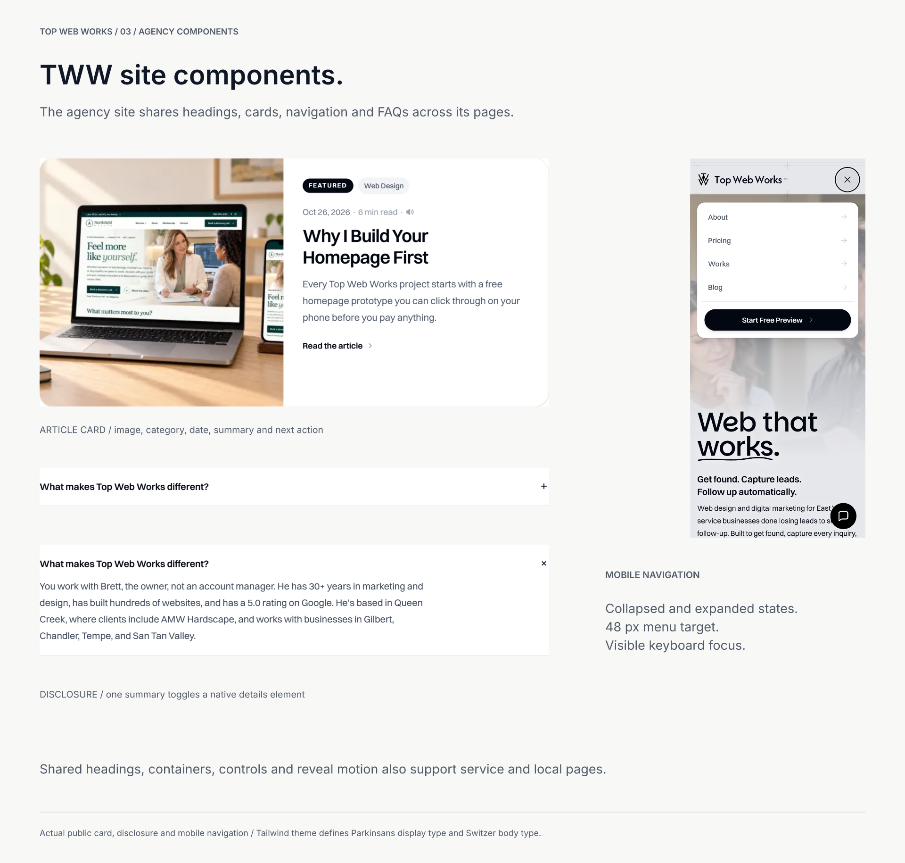
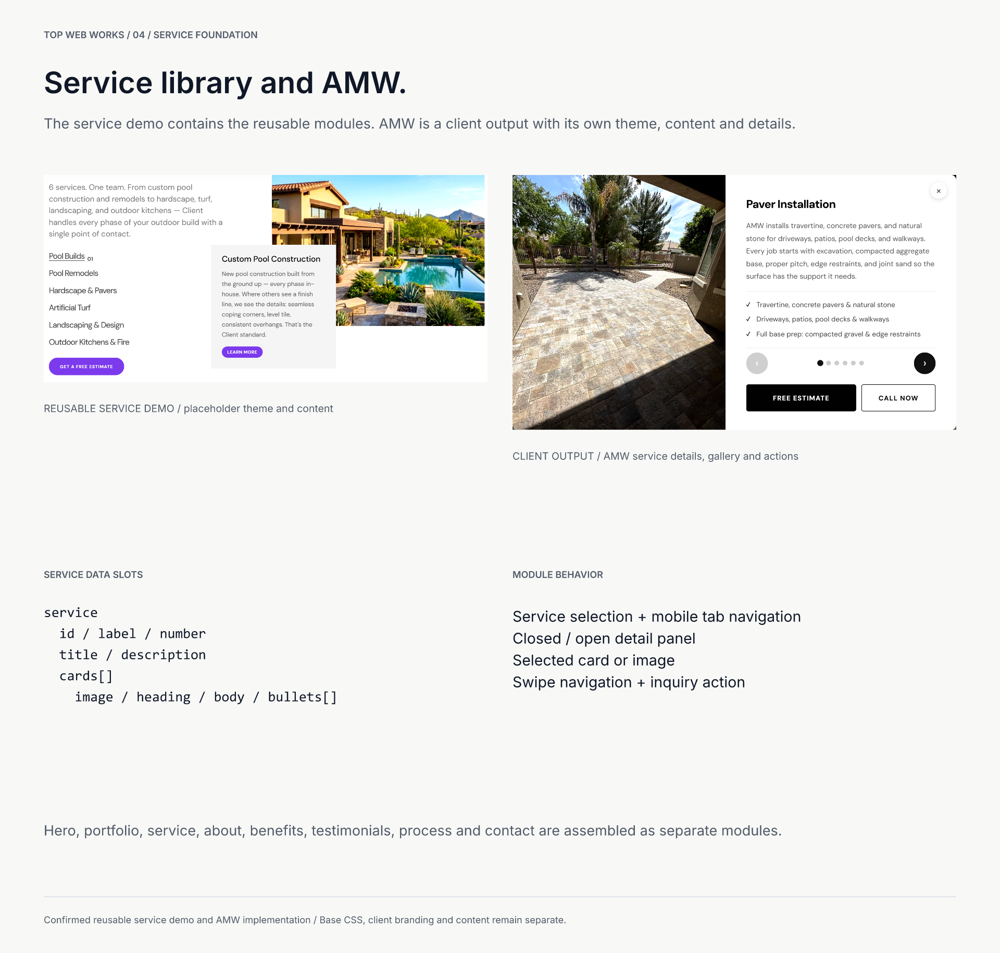
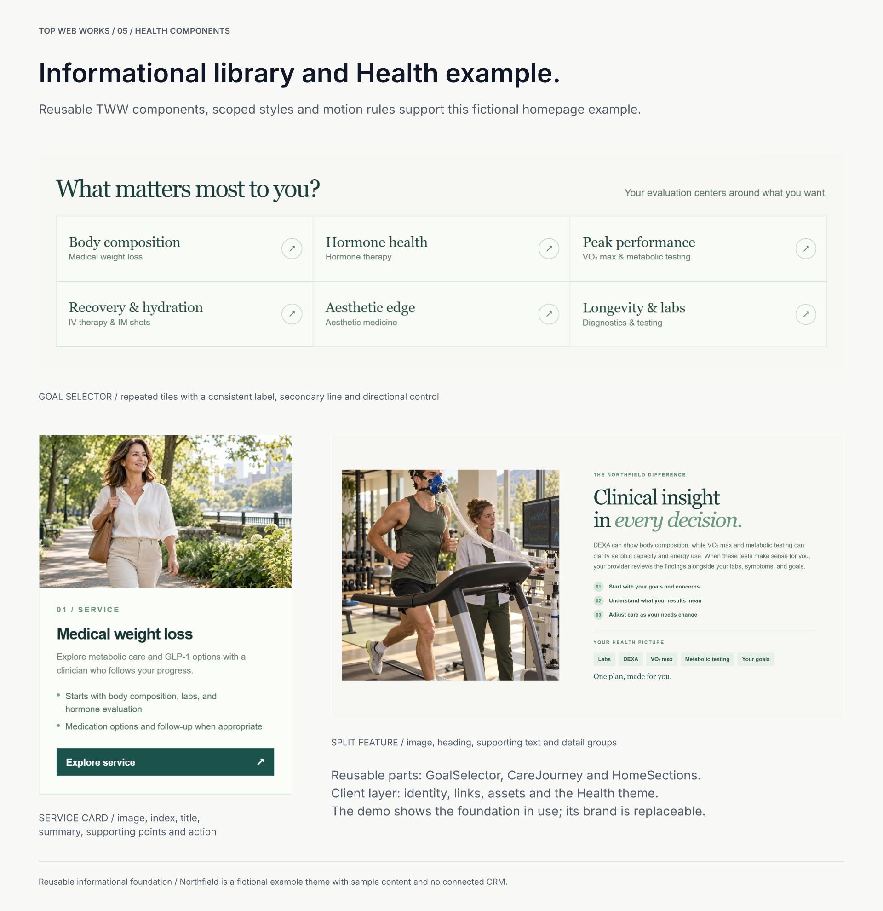
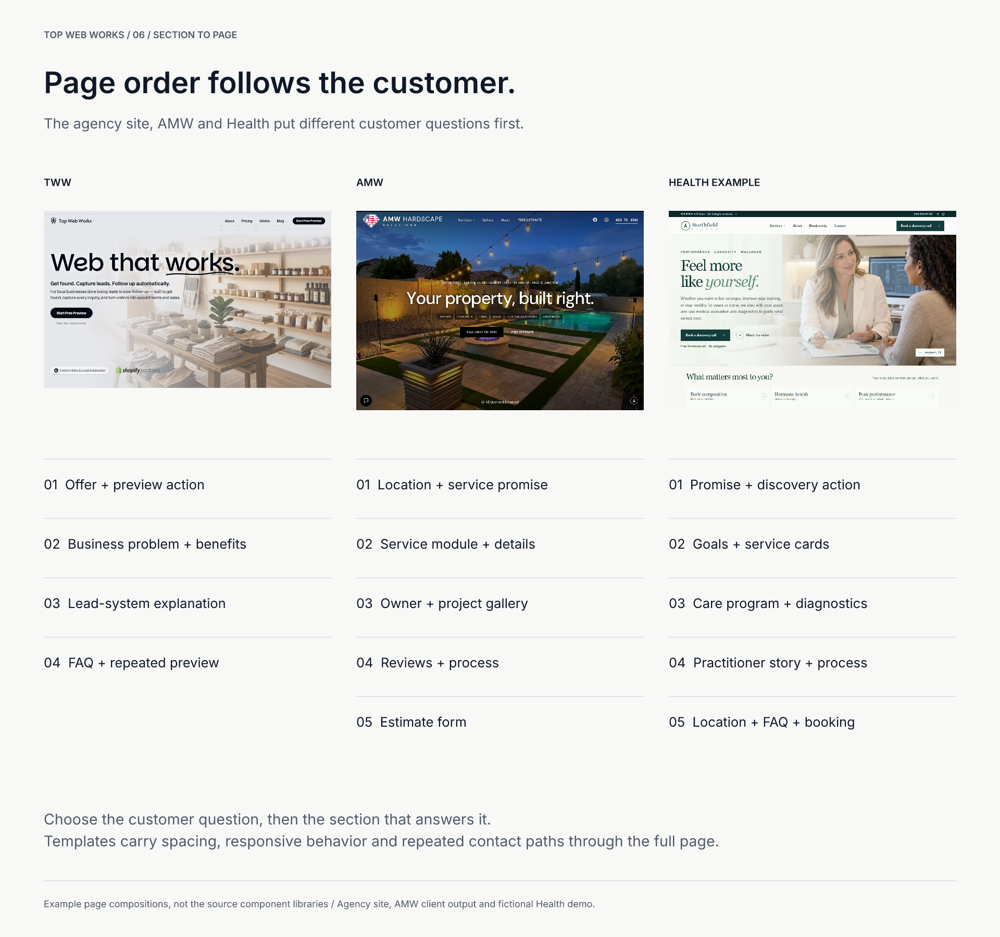
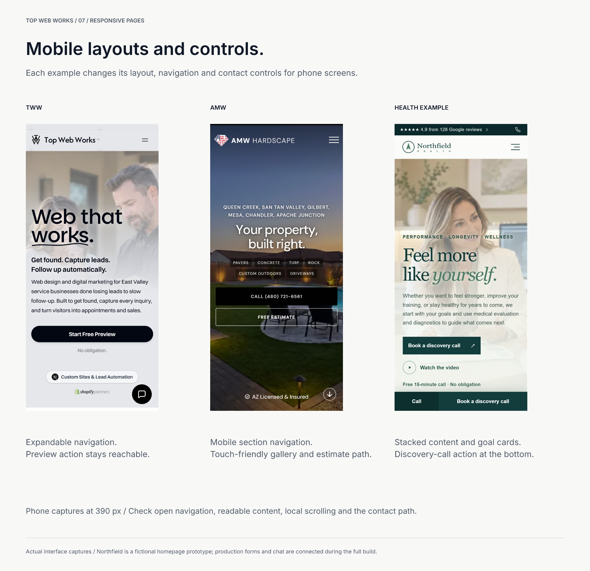
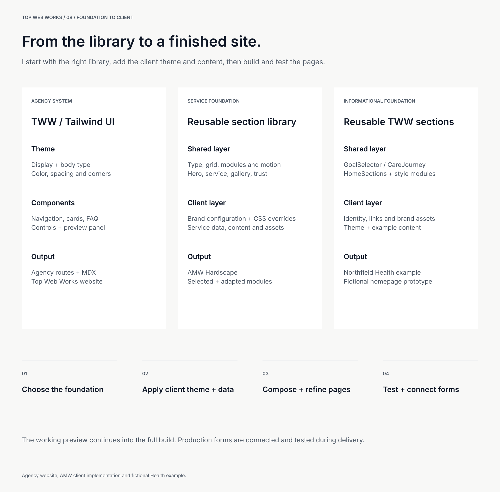
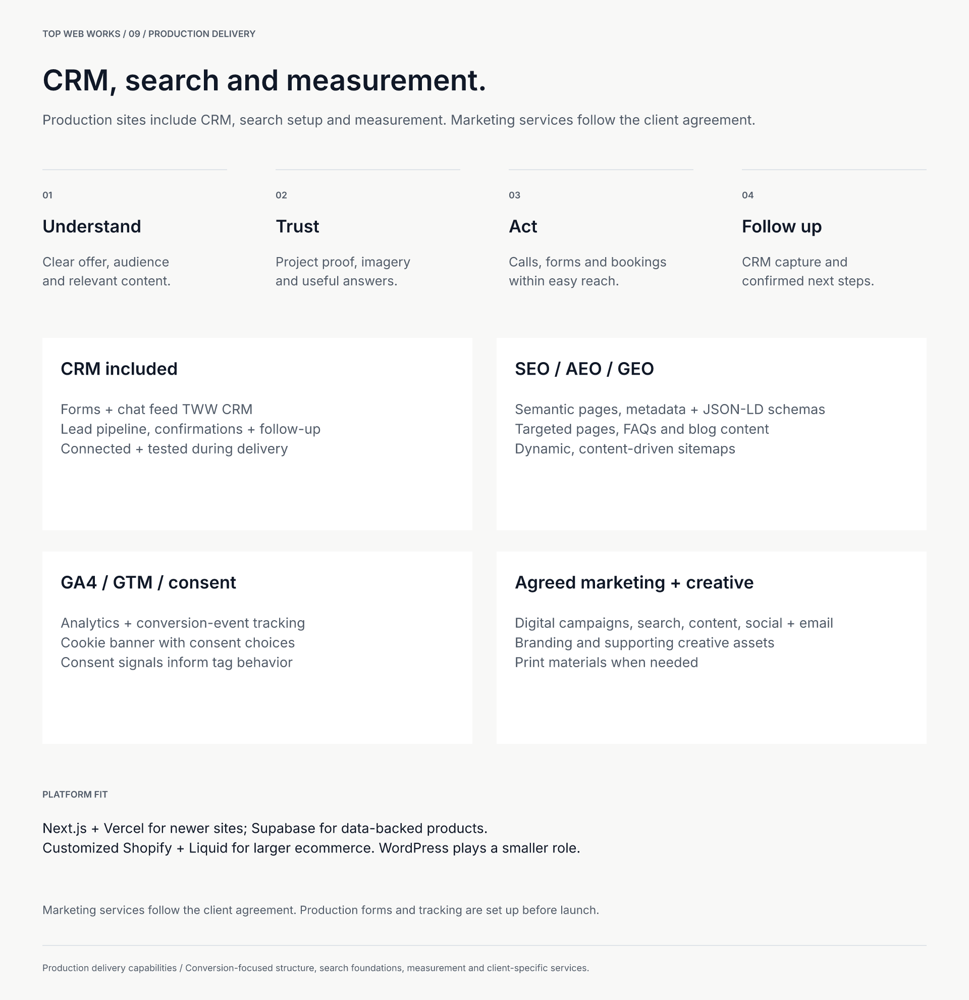

## The Brief

At Top Web Works, I handle design and development together, including the identity, frontend and CRM setup. I use one design system for the agency site and two reusable libraries for client work.

## The Rebrand

I designed the new logo lockup as part of the TWW rebrand. It pairs my symbol with an Afacad wordmark and a service mark. I built it into the shared header, with a short letter wave on hover.

## Three Design Systems

- **Agency site:** customized Tailwind UI, with the agency's theme and Next.js components for marketing pages and articles.
- **Service-site library:** reusable sections and controls for client builds. [AMW Hardscape](/projects/amw-hardscape) is a finished site built from it.
- **Informational-site library:** a separate Next.js starting point for a different audience and reading pace. The [fictional Northfield Health homepage](https://tww-prototype.vercel.app/) shows one way to use it.

Client branding and content sit apart from the shared code. A new business gets its own theme, photographs, copy and page order.

## Tokens and Client Themes

The agency theme uses Parkinsans for display type and Switzer for body text. Its spacing unit is 4 pixels. The homepage action has a 500 ms transition and lifts 2 pixels on hover.

The service library defines shared CSS properties for type, container width, section spacing and motion. Its defaults include DM Sans, a 1350-pixel container, 120-pixel section spacing and a 270 ms transition. A separate brand layer sets colors, tints, overlays and corners. The demo uses a 50-pixel base radius; AMW uses a 4-pixel base and a 10-pixel detail panel.

Northfield's theme uses `--pine`, `--sage`, `--cream`, `--ink` and `--muted`, with Georgia headings and Arial body and control text. Its body-size token changes from 16 to 15 pixels at 600 pixels and below.

[Inspect the token snapshot](/demo/topwebworks/design-system-tokens.json), including the responsive overrides and component measurements.

## TWW Site Components

The agency site shares navigation, headings, article cards, FAQs and the preview-request panel across its pages. An article card brings together an image, category, date, summary and link.

FAQs use native `details` and `summary` elements. The mobile menu has collapsed and expanded states, a 48-pixel trigger and visible keyboard focus.

## The Service Library and AMW

The service library is built on a Resonance/Bootstrap base. I keep reusable hero, portfolio, service, about, benefits, testimonial, process and contact sections. Brand settings and CSS overrides are separate from the section code.

AMW shows how I adapt that library. Its service view combines a project photograph, description and Learn More action. The detail panel adds supporting information, a gallery, image navigation, Call and Estimate actions.

Service data supplies categories, titles, descriptions, images and supporting points. The module handles selection, open and closed panels, and swipe navigation. AMW adds its own content, photographs and theme.

## The Informational Library and Health Example

In this library, `GoalSelector` builds tiles from titles, service labels and links. `CareJourney` and `HomeSections` provide larger sections. I used these components for the Northfield homepage.

Each goal tile has a serif title, secondary text and directional control, with 250 ms background feedback on hover. Service cards repeat an image, index, title, description, supporting points and action. Larger image-and-text sections break up the grids.

The client name, metadata, links, theme and brand assets are configured for each build. Northfield is fictional: its people, reviews and business details are samples, and its CRM form and chat are not connected.

## Page Order and Conversion

I arrange sections around the decision the visitor needs to make. TWW explains the service and asks for a preview request. AMW puts service information and completed work near the estimate path. Health starts with the visitor's goal, then explains the care, people and process before asking for a discovery call.

## Mobile Behavior

TWW opens its navigation into a menu. AMW keeps section tabs and gallery controls usable on touch screens. Health stacks its content and keeps the discovery-call action at the bottom.

This recording shows the TWW FAQ, Health goal-card feedback and the jump to its linked section.

<video controls playsinline preload="none" poster="/demo/topwebworks/design-system-interactions-poster.webp" width="1280" height="900">
  <source src="/demo/topwebworks/design-system-interactions.mp4" type="video/mp4">
  <a href="/demo/topwebworks/design-system-interactions.mp4">Watch the live design-system interactions.</a>
</video>

## From Preview to Finished Site

For a new client, I start with the service or informational library and configure the brand, content and sections. I send the owner a working homepage to review. The approved version becomes the starting point for the full site, where I finish the remaining pages, replace sample material and connect the CRM forms and chat.

## CRM, Search and Measurement

I plan the copy, project proof and calls to action around getting a call, inquiry or booking. I use GA4 to measure those actions after launch.

Production delivery includes:

- **TWW CRM:** connected forms and chat, a lead pipeline, confirmations and follow-up.
- **SEO, AEO and GEO:** semantic pages, metadata, appropriate JSON-LD schemas, useful FAQs and targeted service, local and blog content. Dynamic sitemaps follow the published routes and content.
- **GA4 and GTM:** analytics and conversion tracking, with a cookie banner controlling consent for tracking tags.
- **Agreed marketing services:** digital campaigns, search and content, social and email, plus branding, creative assets and print materials when needed.

## Platform Choices

Most of my new sites use Next.js and Vercel. I use Supabase for [product data and user accounts](/projects/pushpad). For larger ecommerce work, I [customize Shopify storefronts with Liquid](/projects/shopify-migrations). WordPress is a smaller part of my current work.

[Read my design-system approach](/blog/design-systems), [see how the homepage preview works](https://topwebworks.com/blog/why-i-build-your-homepage-first), or [download the design-system notes](/demo/topwebworks/topwebworks-system-notes.pdf).
